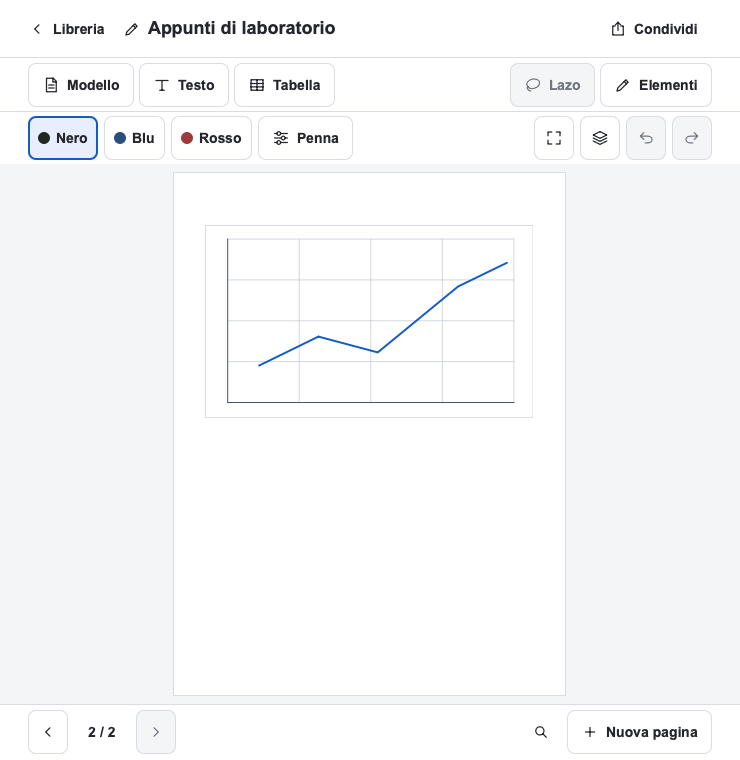

# Quaderno

[Migliorie e migrazione di Quaderno 0.2](docs/AGGIORNAMENTO_0_2.md) · [English](docs/en/UPGRADE_0_2.md)

[Usabilità 0.2.1: 31 migliorie](docs/USABILITA_0_2_1.md) · [English](docs/en/USABILITY_0_2_1.md)

[English](README.md) · **Italiano**

Quaderno è un’app nativa sperimentale per prendere appunti su **reMarkable Paper Pro** e **Mac Apple Silicon**. Riunisce scrittura a penna, testo, tabelle e annotazioni di documenti in una libreria salvata sul dispositivo.

*Schermata della build Mac con dati di esempio.*

## Cosa puoi fare

- Esplorare **Libri**, **Scrittura**, **Grafici**, **Tabelle** e **Diagrammi**. Organizzare quaderni e libri in cartelle, filtrarli per preferiti o tag e recuperarli dal cestino.
- Scrivere in Markdown accanto a tratti a mano libera, immagini, grafici e tabelle. Usare cinque modelli di pagina, livelli d’inchiostro, forme intelligenti e il lazo.
- Importare file CSV o TSV in tabelle modificabili, calcolare somme e medie ed esportare i risultati in CSV.
- Creare grafici a linee e a barre da punti modificabili oppure collegarli a una tabella della stessa pagina. Convertire uno schizzo in un grafico modificabile ed esportare i dati calibrati in CSV.
- Creare quaderni nella quinta sezione **Diagrammi**. Rivedere la proposta ricavata da un diagramma a mano libera, aggiungere forme e frecce a un diagramma esistente, modificarne forme, etichette e frecce e riusarlo in altre pagine. Esportare `.drawio` oppure Markdown con PNG del diagramma e allegato `.drawio` modificabile. [Diagrammi](docs/DIAGRAMMI.md)
- Evidenziare e sottolineare PDF ed EPUB senza DRM a impaginazione fluida. Collocare un **Post-it** in un punto della pagina, scriverci con tastiera o penna e riaprire il richiamo numerato per modificarlo. Usare zoom e segnalibri, cercare il testo nei PDF appena importati ed esportare le pagine annotate con appendici leggibili per le note. [Note sui libri](docs/NOTE_LIBRI.md)
- Importare su Mac copie locali in PDF ed EPUB senza DRM da Apple Books e inviare la copia annotata al Paper Pro con Quaderno. [Apple Books sul Mac](docs/GUIDA.md#note-libri-e-icloud-sul-mac)
- Importare Markdown modificabile, anche da un URL HTTPS diretto. Esportarlo con immagini collegate per l’inchiostro, i grafici, i diagrammi e le immagini incorporate. Su Mac puoi salvare il testo in un vault Obsidian. Su Mac e Paper Pro puoi copiare i collegamenti a un sito Obsidian Publish. [Markdown e Obsidian](docs/GUIDA.md#markdown-e-obsidian)
- Sincronizzare le note Markdown direttamente tra Paper Pro e Obsidian Sync via Wi‑Fi dopo la prima configurazione via USB‑C. [Obsidian Sync sul Paper Pro](docs/GUIDA.md#obsidian-sync-sul-paper-pro)
- Trasferire e sincronizzare interi quaderni tra Mac e Paper Pro tramite Bluetooth LE o Wi‑Fi locale, comprese evidenziazioni, sottolineature e note modificabili su tutte le pagine dei libri. Scegliere il collegamento automatico e sincronizzare dopo le modifiche, all’apertura di un quaderno selezionato o a intervalli. Entrambe le app devono essere aperte, sbloccate e compatibili con il formato del quaderno. [Sincronizzazione wireless](docs/PROTOCOLLO_SYNC.md) Il trasferimento via USB‑C resta disponibile dalla libreria e dall’editor. Condividere copie PDF con Note dal menu del Mac, oppure salvare un PDF e importarlo in Apple Books.
- Cercare e abbinare accessori Bluetooth sul Paper Pro, come le tastiere HID. [Collegare una tastiera Bluetooth](docs/GUIDA.md#collegare-una-tastiera-bluetooth)
- Trascrivere offline la scrittura a mano in italiano e inglese con il motore per Paper Pro o su macOS 27 e successivi. Correggere il testo e cercarlo per riaprire la pagina manoscritta originale.
- Scegliere l’inglese o l’italiano per l’interfaccia. Sul Paper Pro puoi passare da QWERTY italiano a inglese USA mentre scrivi e modificare i blocchi di testo con un tocco.
- Nella 0.2.7 puoi personalizzare lettura e scrittura, strumenti, filtro del palmo, orologio, automazioni Wi-Fi, backup e cache. Puoi esplorare Google Drive, Dropbox e OneDrive dopo la configurazione delle registrazioni OAuth di Quaderno e l’accesso al tuo account. [Impostazioni e servizi collegati](docs/IMPOSTAZIONI.md)

- Sul Paper Pro, attivare la rotazione automatica dell’interfaccia con un sensore supportato. Restano disponibili angoli manuali e orientamento di lettura per libro. [Impostazioni di rotazione](docs/IMPOSTAZIONI.md#rotazione-lettura-e-schermo-intero)

## Comandi per ogni sezione

La barra contestuale segue la sezione aperta. Nella 0.2.12 i comandi frequenti sono in vista e gli altri sono in **Altro**. Restano disponibili i comandi comuni per penna, lazo e pagine. Vedi lo [schema completo di funzioni e flussi](docs/FUNZIONI_E_FLUSSI.md).

| Sezione | Azioni principali |
| --- | --- |
| **Libri** | Evidenziare, sottolineare, aggiungere Post-it, trovare le pagine annotate e sincronizzare il libro intero. Restano i controlli di lettura per zoom e segnalibri. |
| **Scrittura** | Creare o modificare Markdown, aggiungere testo e immagini e inserire contenuti dalla libreria. |
| **Grafici** | Modificare i dati, creare un grafico, ricavarlo da una tabella della pagina ed esportare CSV. |
| **Tabelle** | Modificare celle e formule, creare tabelle o importare CSV, generare un grafico ed esportare CSV. |
| **Diagrammi** | Riconoscere diagrammi di flusso manoscritti, inserire forme, modificare un diagramma esistente e importare `.drawio`. |

Un’azione apre direttamente l’unico oggetto compatibile; se la pagina contiene più candidati, scegli quello desiderato. Tabelle e grafici collegati, diagrammi e scrittura possono condividere la pagina: la sezione cambia le scorciatoie disponibili, non il contenuto modificabile. Vedi [sezioni e scambio dei file](docs/FUNZIONALITA.md).

Per trasferire le annotazioni sincronizza il **libro di Quaderno**, comprese pagine e sorgente originale. Copiare soltanto il PDF o l’EPUB originale non trasferisce le annotazioni di Quaderno. Con l’automatismo all’apertura, le modifiche fatte mentre il libro rimane aperto attendono un nuovo evento; scegli **Dopo le modifiche** per sincronizzare automaticamente dopo i salvataggi. I nuovi Post-it richiedono la **0.2.11 su entrambe le app**. [Note e sincronizzazione dei libri](docs/NOTE_LIBRI.md)

## Compatibilità e stato

| Piattaforma | Stato della build |
| --- | --- |
| Mac Apple Silicon | La build locale attuale richiede **macOS 27.2 o successivo**. I requisiti delle build da sorgente dipendono dal kit Qt e dalla versione minima impostata in compilazione. |
| reMarkable Paper Pro (`ferrari`) | Firmware **3.29.1.0**. Quaderno è stato avviato su un tablet fisico con AppLoad, input nativo del Marker e refresh e‑ink. |

La prova sul Paper Pro usa la modalità sviluppatore. **Attivarla ripristina il tablet alle impostazioni di fabbrica.** Salva i tuoi documenti prima di attivarla. La sessione di Quaderno è temporanea e gli script avviano di nuovo l’interfaccia reMarkable alla chiusura. [Guida ufficiale alla modalità sviluppatore](https://developer.remarkable.com/documentation/developer-mode)

Quaderno salva la libreria in un formato locale. I trasferimenti USB‑C partono su richiesta. Per indicizzare il testo incorporato in un PDF già presente in libreria, occorre importarlo di nuovo.

## Per iniziare

Questi sorgenti sono la **0.2.12 in sviluppo**. Aggiunge una barra compatta per sezione, importazione CSV e draw.io dal selettore dei file e gesture a due dita sui fogli.

Sul Paper Pro è installata la **0.2.11**. L’app Mac installata è la **0.2.0**. Per i quaderni con Post-it, usa la 0.2.11 o una versione successiva su entrambi. Consulta la [cronologia](CHANGELOG.it.md), la [compatibilità dei dati](docs/DATI.md#versioni-della-libreria) e la [guida al rilascio](docs/RILASCIO.md).

Nella precedente 0.2.6 batteria della penna e tocchi dito/Marker in orizzontale sono stati confermati fisicamente sul Paper Pro. I nuovi collegamenti cloud richiedono ancora le registrazioni OAuth di Quaderno e il collaudo con account reali. I pacchetti corretti della 0.2.7 hanno superato le regressioni interessate e i controlli d’avvio più rigorosi; l’installazione sul Paper Pro si avvia senza gli avvisi di inizializzazione del dialogo cloud. La finestra usa ora l’overlay del dispositivo anziché il Loader senza dimensioni. Il 18 novembre 2026 l’utente ha confermato che tutte e tre le finestre degli account cloud si aprono sul tablet. La conferma riguarda l’interfaccia, non l’autorizzazione dei provider o i trasferimenti. Gli archivi precedenti restano conservati come evidenza superata. L’app Mac 0.2.0 installata resta invariata. Vedi [impostazioni e stato delle verifiche](docs/IMPOSTAZIONI.md#ambito-delle-verifiche).

- **Sul Mac** apri `Quaderno.app` dal pacchetto Mac Apple Silicon, se disponibile, oppure compila dai sorgenti. [Installazione](docs/INSTALLAZIONE.md) · [Compilazione](docs/SVILUPPO.md)
- **Sul Paper Pro** controlla modello e firmware, quindi usa l’installazione via USB‑C descritta nella guida. [Installazione sul Paper Pro](docs/INSTALLAZIONE.md)
- **Nell’app** crea un quaderno, scegli un modello di pagina e scrivi. Il contatore in basso apre le miniature e le azioni sulle pagine. [Guida d’uso](docs/GUIDA.md)

## Documentazione

| Guida | Contenuto |
| --- | --- |
| [Usabilità 0.2.1](docs/USABILITA_0_2_1.md) | 31 nuove migliorie, flussi d’uso, stato delle verifiche e sviluppi successivi |
| [Installazione](docs/INSTALLAZIONE.md) | Mac, USB‑C, AppLoad, aggiornamento e ripristino |
| [Guida d’uso](docs/GUIDA.md) | Libreria, scrittura, grafici, trascrizione e documenti |
| [Impostazioni e servizi collegati](docs/IMPOSTAZIONI.md) | Venti gruppi di impostazioni, rotazione automatica, riconoscimento dei diagrammi, lettura, automazioni e limiti per piattaforma |
| [Configurazione account cloud](docs/CLOUD_ACCOUNTS.md) | Registrazioni OAuth, assistente di accesso, trasferimenti manuali, sicurezza e prove reali ancora da svolgere |
| [Manutenzione della libreria](docs/LIBRARY_MAINTENANCE.md) | Backup pianificati, conservazione verificata, limiti cache e preferenze locali di lettura |
| [Sezioni e scambio dei file](docs/FUNZIONALITA.md) | Libri, Scrittura, Grafici, Tabelle, Diagrammi, formati e riuso dei contenuti |
| [Diagrammi](docs/DIAGRAMMI.md) | Riconoscimento a mano libera, revisione delle etichette, forme modificabili, recupero dei tratti e riuso |
| [Note sui libri](docs/NOTE_LIBRI.md) | Post-it ancorati, tastiera e scrittura a mano, sincronizzazione del libro, appendici PDF e allegati Markdown |
| [Sincronizzazione wireless](docs/PROTOCOLLO_SYNC.md) | Automatismi Wi-Fi/Bluetooth, libri annotati, controllo delle versioni e recupero dei trasferimenti |
| [Dati e backup](docs/DATI.md) | Posizione dei file, copie di sicurezza, importazione e PIN |
| [Sviluppo](docs/SVILUPPO.md) | Architettura, compilazione e verifiche |
| [Preparazione del rilascio](docs/RILASCIO.md) | Stato dei pacchetti, collaudo e distribuzione |
| [Cronologia](CHANGELOG.it.md) | Funzioni incluse nella versione in sviluppo |

## Contributi e sicurezza

Per correzioni e segnalazioni consulta [CONTRIBUTING.it.md](CONTRIBUTING.it.md). Per problemi di sicurezza consulta [SECURITY.it.md](SECURITY.it.md).

Quaderno è un progetto indipendente. Il codice dell’app è disponibile con licenza [MIT](LICENSE). Il componente opzionale WritePad usa la licenza GPL-3.0-or-later. [Licenze dei componenti di terze parti](THIRD_PARTY_NOTICES.md)
