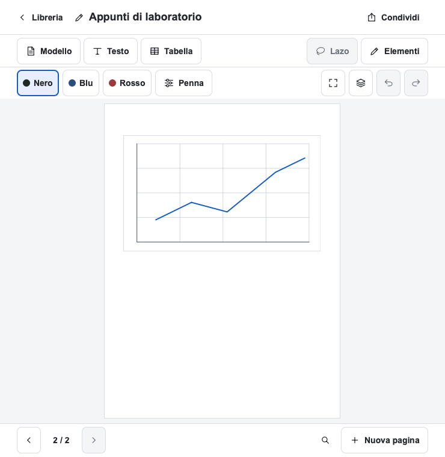

# Quaderno

[Quaderno 0.2 improvements and migration notes](docs/en/UPGRADE_0_2.md) · [Italiano](docs/AGGIORNAMENTO_0_2.md)

[0.2.1 usability update: 31 improvements](docs/en/USABILITY_0_2_1.md) · [Italiano](docs/USABILITA_0_2_1.md)

**English** · [Italiano](README.it.md)

Quaderno is an experimental native note-taking app for **reMarkable Paper Pro** and **Macs with Apple silicon**. It brings handwriting, text, tables, and document annotations together in a library stored on your device.

*Mac preview with sample data.*

## What you can do

- Browse **Books**, **Writing**, **Charts**, **Tables**, and **Diagrams**. Organize notebooks and books into folders, filter by favorites or tags, and restore items from the trash.
- Write Markdown alongside freehand ink, images, charts, and tables. Use five paper templates, ink layers, smart shapes, and the lasso.
- Import CSV or TSV files into editable tables, calculate sums and averages, and export the results as CSV.
- Create line and bar charts from editable points or link them to a table on the same page. Convert hand-drawn sketches to editable charts and export calibrated data as CSV.
- Create diagram notebooks in the fifth **Diagrams** section. Review a hand-drawn flowchart proposal, add new freehand shapes and arrows to an existing diagram, edit its shapes, labels and arrows, and reuse it on other pages. Export `.drawio` files or Markdown with a diagram PNG and editable `.drawio` attachment. [Diagrams](docs/en/DIAGRAMS.md)
- Highlight and underline PDFs and DRM-free, reflowable EPUBs. Place a **Post-it** at a point on the page, type or write inside it, and reopen its numbered marker to edit it. Zoom, bookmark pages, search text in newly imported PDFs, and export annotated pages with readable note appendices. [Book notes](docs/en/BOOK_NOTES.md)
- Import local PDF and DRM-free EPUB copies from Apple Books on Mac, then send the annotated copy to Paper Pro with Quaderno. [Apple Books on Mac](docs/en/USER_GUIDE.md#notes-books-and-icloud-on-mac)
- Import editable Markdown, including from a direct HTTPS URL. Export it with linked images for ink, charts, diagrams, and embedded photos. On Mac, save the text in an Obsidian vault. On Mac and Paper Pro, copy links to an Obsidian Publish site. [Markdown and Obsidian](docs/en/USER_GUIDE.md#markdown-and-obsidian)
- Sync Markdown notes directly between Paper Pro and Obsidian Sync over Wi‑Fi after one-time setup over USB‑C. [Obsidian Sync on Paper Pro](docs/en/USER_GUIDE.md#obsidian-sync-on-paper-pro)
- Transfer and sync whole Quaderno notebooks between Mac and Paper Pro over Bluetooth LE or local Wi-Fi, including book highlights, underlining and editable notes on every page. Choose the automatic connection and sync after edits, on opening a selected notebook or at intervals. Both apps must be open, unlocked and compatible with the notebook format. [Wireless synchronization](docs/en/SYNC_PROTOCOL.md) USB-C transfers remain available from the library and editor. Share PDF copies with Apple Notes from the Mac share menu, or save a PDF and import it in Apple Books.
- Scan for and pair Bluetooth accessories such as HID keyboards on Paper Pro. [Connect a Bluetooth keyboard](docs/en/USER_GUIDE.md#connect-a-bluetooth-keyboard)
- Transcribe Italian and English handwriting offline with the Paper Pro handwriting engine or on macOS 27 or later. Review the text, then search it to reopen the original ink page.
- Choose English or Italian for the interface. On Paper Pro, switch between Italian and US English QWERTY while typing, and edit existing text blocks with a tap.
- In 0.2.7, customize reading and writing, toolbar actions, palm rejection, clock, Wi-Fi automation, backups and cache. Browse Google Drive, Dropbox and OneDrive after the maintainer configures Quaderno’s OAuth registrations and you sign in. [Settings and connected services](docs/en/SETTINGS.md)

- On Paper Pro, optionally rotate the interface with a supported orientation sensor. Manual angles and per-book reading orientation remain available. [Rotation settings](docs/en/SETTINGS.md#rotation-reading-and-full-page-view)

## Controls for each section

The context toolbar follows the section you open. Version 0.2.12 keeps the most common actions in view and places secondary actions under **More**. Common pen, lasso and page controls remain available.

| Section | Main actions |
| --- | --- |
| **Books** | Highlight, underline, place Post-its, find annotated pages and synchronize the whole book. Keep reading controls for zoom and bookmarks. |
| **Writing** | Create or edit Markdown, add text and images, and insert content from the library. |
| **Charts** | Edit chart data, create a chart, derive one from a table on the page, and export CSV. |
| **Tables** | Edit cells and formulas, create or import CSV tables, build a chart from a table, and export CSV. |
| **Diagrams** | Recognize freehand flowcharts, insert shapes, edit an existing diagram, and import `.drawio`. |

An action opens the only matching object directly; if a page contains several candidates, choose the intended one. Tables and linked charts, diagrams and writing can share a page; the section changes the available shortcuts, not the editable content. See the [complete function and workflow map](docs/en/FUNCTIONS_AND_WORKFLOWS.md).

For annotations to reach the other device, synchronize the **Quaderno book**, including its pages and original source. Copying the original PDF or EPUB alone does not carry Quaderno's annotations. With opening-based automation, changes made while a book stays open wait for another trigger; choose **After changes** for automatic synchronization after saved edits. New Post-its require **0.2.11 on both apps**. [Book notes and synchronization](docs/en/BOOK_NOTES.md)

## Compatibility and status

| Platform | Build status |
| --- | --- |
| Mac with Apple silicon | The current local build targets **macOS 27.2 or later**. Requirements for source builds depend on the Qt kit and deployment target. |
| reMarkable Paper Pro (`ferrari`) | Firmware **3.29.1.0**. Quaderno has run on a physical tablet with AppLoad, native Marker input, and e-paper refresh. |

Trying Quaderno on the Paper Pro requires Developer Mode. **Enabling Developer Mode resets the tablet to factory settings.** Back up your documents first. Quaderno runs in a temporary session, and the scripts restart the reMarkable interface when that session ends. [Official Developer Mode guide](https://developer.remarkable.com/documentation/developer-mode)

Quaderno stores its library in a local format. USB-C transfers run when you request them. A previously imported PDF needs to be imported again to index its embedded text.

## Getting started

This source tree is **0.2.12 in development**. It adds a compact section toolbar, file-first import for CSV and draw.io, and two-finger gestures on sheets.

Paper Pro is running **0.2.11**. The installed Mac app is **0.2.0**. Use 0.2.11 or later on both devices for notebooks with Post-its. See the [changelog](CHANGELOG.md), [data compatibility guide](docs/en/DATA.md#library-format-versions), and [release guide](docs/en/RELEASE.md).

The earlier 0.2.6 pen battery and landscape touch/Marker behavior were physically confirmed on Paper Pro. The new cloud connections still require maintainer OAuth registrations and live account validation. The corrected 0.2.7 packages passed the affected regressions and stricter startup checks, and the Paper Pro installation starts without the cloud-dialog initialization warnings. The popup is now attached to the window overlay instead of its zero-size loader. On November 18, 2026, the user confirmed that all three cloud account windows open on the tablet. This confirms the interface, not provider authorization or file transfers. Earlier archives are retained as superseded evidence. The installed Mac 0.2.0 app remains unchanged. See the [settings verification status](docs/en/SETTINGS.md#verification-boundary) and the release guide for downloadable package status. [Release preparation](docs/en/RELEASE.md)

- **On Mac**, open `Quaderno.app` from the Apple silicon package if you have it, or build from source. [Installation](docs/en/INSTALLATION.md) · [Build instructions](docs/en/DEVELOPMENT.md)
- **On Paper Pro**, check your model and firmware, then follow the USB-C installation steps. [Paper Pro installation](docs/en/INSTALLATION.md)
- **In Quaderno**, create a notebook, choose a page template, and start writing. Select the page count at the bottom to open thumbnails and page actions. [User guide](docs/en/USER_GUIDE.md)

## Documentation

| Guide | Contents |
| --- | --- |
| [0.2.1 usability update](docs/en/USABILITY_0_2_1.md) | 31 new improvements, workflows, validation status, and follow-up work |
| [Installation](docs/en/INSTALLATION.md) | Mac, USB-C, AppLoad, updates, and recovery |
| [User guide](docs/en/USER_GUIDE.md) | Library, writing, charts, transcription, and documents |
| [Settings and connected services](docs/en/SETTINGS.md) | Twenty settings groups, automatic rotation, diagram recognition, reading preferences, automation and platform limits |
| [Cloud account setup](docs/en/CLOUD_ACCOUNTS.md) | OAuth registrations, sign-in assistant, manual transfers, security and pending live checks |
| [Local library maintenance](docs/en/LIBRARY_MAINTENANCE.md) | Scheduled backups, verified retention, cache limits and local reading preferences |
| [Sections and file workflows](docs/en/FEATURES.md) | Books, Writing, Charts, Tables, Diagrams, file formats, and how content moves between sections |
| [Diagrams](docs/en/DIAGRAMS.md) | Hand-drawn recognition, label review, editable shapes, original ink recovery and reuse |
| [Book notes](docs/en/BOOK_NOTES.md) | Anchored Post-its, keyboard and handwriting, whole-book sync, PDF appendices and Markdown assets |
| [Wireless synchronization](docs/en/SYNC_PROTOCOL.md) | Wi-Fi/Bluetooth automation, annotated books, version checks and transfer recovery |
| [Data and backups](docs/en/DATA.md) | File locations, backups, importing, and the app PIN |
| [Development](docs/en/DEVELOPMENT.md) | Architecture, builds, and testing |
| [Release preparation](docs/en/RELEASE.md) | Package status, testing, and distribution |
| [Changelog](CHANGELOG.md) | Features in the development preview |

## Contributing and security

See the [contribution guide](CONTRIBUTING.md) for fixes and bug reports and the [security policy](SECURITY.md) for vulnerability reports.

Quaderno is an independent project. The application code is available under the [MIT License](LICENSE). The optional WritePad helper uses GPL-3.0-or-later. [Third-party notices](THIRD_PARTY_NOTICES.md)
