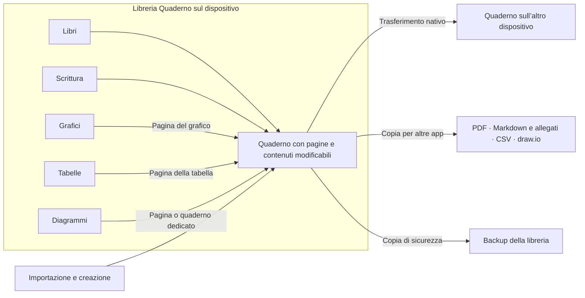
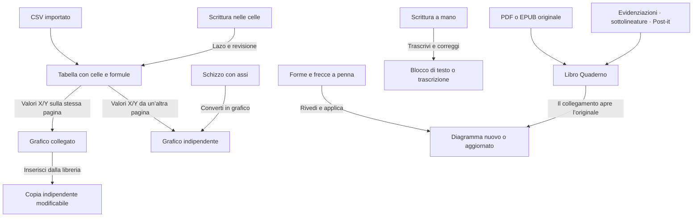

# Mappa delle funzioni e dei flussi di Quaderno

**Italiano** · [English](en/FUNCTIONS_AND_WORKFLOWS.md)

Il quaderno salvato è l’unità da conservare e trasferire se vuoi continuare a modificarlo. Le cinque sezioni aiutano a trovare contenuti diversi nella stessa libreria. La mappa comprende l’interfaccia **0.2.17 in sviluppo** e distingue le funzioni condivise da quelle che dipendono da Mac, Paper Pro, firmware o account esterni.

[Struttura](#come-si-organizza-il-lavoro) · [Sezioni](#le-cinque-sezioni) · [Strumenti comuni](#strumenti-comuni-e-gesti) · [Scambio dei contenuti](#come-interagiscono-i-contenuti) · [Dispositivi e servizi](#dispositivi-e-servizi) · [Salvataggio e verifiche](#salvataggio-e-verifiche)

## Come si organizza il lavoro

| Livello | Cosa contiene | Effetto delle operazioni |
| --- | --- | --- |
| Libreria | Quaderni, cartelle, preferiti, tag e cestino. Puoi cercare per nome o tag, filtrare per sezione o formato e ordinare per titolo o numero di pagine dove disponibile. | Spostare un quaderno in una cartella cambia la sua collocazione. Il cestino consente il ripristino fino all’eliminazione definitiva. |
| Quaderno | Titolo, pagine ordinate, eventuale sorgente importata o Markdown, lingua di riconoscimento e segnalibri. | Aprire una voce di Grafici, Tabelle o Diagrammi porta alla pagina di origine. L’editor si apre con un’azione esplicita. |
| Pagina | Sfondo PDF/EPUB o foglio con modello, livelli d’inchiostro, tag e oggetti posizionati. | In **Pagine** puoi filtrare per segnalibri o annotazioni, saltare a un numero, duplicare, riordinare, eliminare o spostare una pagina. La ricerca del testo apre la pagina del risultato. |
| Oggetto | Testo, immagine, tabella, grafico, diagramma, Post-it o collegamento di pagina. | Modificare l’oggetto sulla pagina cambia l’originale. **Dalla libreria** inserisce copie indipendenti di grafici, tabelle o diagrammi. Una tabella e il suo grafico collegato condividono i dati sulla stessa pagina. |
| Vista | Pagina aperta, zoom, margini, orientamento e preferenze di lettura locali. | Cambiare la vista non modifica la revisione del quaderno. **Continua** può chiedere all’altro dispositivo di aprire una pagina compatibile con la revisione ricevuta. |

## Le cinque sezioni

Ogni sezione ha una barra dedicata. Libri può mostrare fino a quattro azioni principali e le altre sezioni fino a tre, secondo lo spazio disponibile. Gli altri comandi sono in **Altro**. Un comando con un solo oggetto compatibile sulla pagina lo apre direttamente. Se le destinazioni possibili sono più di una, puoi scegliere quale usare. Nelle finestre più strette i comandi di zoom e segnalibri si dispongono su due righe.

**Importa CSV** in Tabelle e **Importa draw.io** in Diagrammi aprono prima la scelta del file. Dopo la conferma aprono l’editor con una bozza. Annullare riporta al foglio. Se nel frattempo cambi pagina, il file non viene applicato alla nuova pagina.

### Libri

| Azione | Percorso e risultato |
| --- | --- |
| Importare | Apri un PDF locale o un EPUB senza DRM a impaginazione fluida. Il Mac offre anche apertura e trascinamento dal Finder, importazione di gruppi di file con rapporto, e scelta di copie locali da Apple Books. Il PDF o EPUB originale è conservato. Il lettore prepara l’importazione in background e renderizza le pagine richieste. |
| Leggere | Libri si apre in modalità lettura. L’inchiostro si attiva quando scegli uno strumento di annotazione. Usa zoom, adattamento a pagina o larghezza, panoramica, pagina precedente/successiva e segnalibri. **Cerca testo** usa il testo estraibile del PDF e quello salvato nelle annotazioni. Una scansione senza livello di testo non viene trascritta dal lettore PDF. |
| Annotare | **Evidenzia** e **Sottolinea** producono tratti modificabili del livello attivo. **Post-it** chiede un punto del foglio e salva un richiamo numerato con testo da tastiera, scrittura a mano o entrambi. Tocca il richiamo per riaprirlo. Il testo digitato è ricercabile. **Elementi** permette di spostare il richiamo. Il punto segue zoom e rotazione. |
| Collegare un oggetto della libreria | Scegli **Collega elemento**, tocca un punto della pagina e seleziona un grafico, una tabella o un diagramma. Tocca il richiamo per aprire la pagina di destinazione con la barra adatta. **Torna al libro** riapre la pagina di partenza. |
| Ritrovare e inviare | **Pagine annotate** raccoglie anche pagine con tratti su livelli nascosti. **Sincronizza libro** apre il flusso nativo, che comprende tutte le pagine e le loro annotazioni. Importare separatamente lo stesso file sorgente crea due identità di quaderno distinte. |
| Condividere | Il PDF annotato mostra i livelli visibili e gli oggetti. Per i Post-it include richiami sulla pagina e appendici con testo impaginato e scrittura. Un’esportazione della pagina corrente include soltanto le sue note. |

Il PDF sorgente arriva a 48 MiB e l’EPUB a 64 MiB. Il PDF preparato da un EPUB deve rientrare in 48 MiB. La resa di stili e risorse dipende dal documento. I limiti di importazione, archiviazione e trasferimento si applicano separatamente. [Lettura](GUIDA.md#leggere-e-annotare-pdf-ed-epub) · [Post-it](NOTE_LIBRI.md)

### Scrittura

| Azione | Percorso e risultato |
| --- | --- |
| Creare e annotare | Crea un quaderno, scegli un modello e scrivi su un livello visibile. La barra compatta raccoglie penna, colore, spessore, preferiti e lazo. Aggiungi blocchi di testo separati e immagini locali supportate. Sposta gli oggetti con **Elementi** o seleziona contenuti misti con il lazo. |
| Scrivere in Markdown | Crea un documento, importa un file UTF-8 o usa un URL HTTPS diretto. **Modifica Markdown** cambia il sorgente e ridistribuisce il testo. Gli elementi e i tratti delle pagine rimangono separati dal sorgente. Il testo importato è limitato a 256 KiB e 200 pagine. |
| Convertire una pagina mista | Sul Paper Pro, **Riconosci pagina mista** propone un diagramma, una tabella e un testo Markdown dalle aree che selezioni. Dopo la revisione, l’unico quaderno contiene il testo e le due pagine collegate e modificabili di diagramma e tabella. Lo stesso comando è disponibile su una pagina PDF importata in Libri. |
| Aprire un oggetto collegato | **Elementi collegati** mostra le anteprime e apre gli oggetti originali per consultarli o modificarli. Se la destinazione è in un altro quaderno, sincronizzala separatamente. |
| Riutilizzare oggetti | **Dalla libreria** aggiunge una copia modificabile di un grafico, una tabella o un diagramma. Puoi anche creare questi oggetti sulla pagina e ritrovarli nella loro sezione. |
| Condividere | Il PDF conserva l’aspetto. Il Markdown esporta testo e, con allegati, immagini, inchiostro e grafici come file immagine. I diagrammi hanno anche un file `.drawio`. Per continuare a modificare i contenuti nativi, trasferisci il quaderno. |

[Scrittura e contenuti](GUIDA.md#scrittura-e-contenuti-della-pagina) · [Riconoscimento di una pagina mista](GUIDA.md#riconoscere-una-pagina-mista-sul-paper-pro) · [Markdown e Obsidian](GUIDA.md#markdown-e-obsidian)

### Grafici

| Percorso | Dati e collegamenti |
| --- | --- |
| Punti indipendenti | Crea un grafico a linee o a barre. Modifica titolo, etichette, punti e scala. Il grafico accetta fino a 128 punti. Una linea richiede almeno due punti. Le barre richiedono almeno un punto e valori X distinti. |
| Da tabella | Scegli la tabella, le colonne X e Y e l’eventuale riga di intestazione. Controlla l’anteprima prima di salvare. Una tabella sulla stessa pagina resta collegata e aggiorna il grafico con valori e risultati delle formule. Una tabella su un’altra pagina fornisce un grafico indipendente e modificabile con i valori calcolati del momento. |
| Da schizzo | Seleziona con il lazo gli assi compatibili e una curva o una serie di barre. **Converti in grafico** permette di correggere i punti, calibrare gli assi e scegliere la pagina di salvataggio. Lo schizzo originale rimane nel quaderno. |
| Riuso ed esportazione | Tocca il grafico o scegli **Dati e aspetto** per aprire l’editor adatto. Una copia da un grafico collegato usa i valori validi del momento e diventa indipendente. Il CSV espone i dati numerici calibrati, inclusi i valori negativi quando presenti. |

[Grafici](FUNZIONALITA.md#grafici) · [Grafici da tabella](GUIDA.md#creare-un-grafico-da-una-tabella)

### Tabelle

| Azione | Percorso e risultato |
| --- | --- |
| Creare e importare | Aggiungi una griglia vuota oppure importa CSV/TSV UTF-8 fino a 256 KiB. La prima riga resta modificabile. La griglia supporta al massimo 12 righe, 8 colonne e 500 caratteri per cella. |
| Modificare | Tocca una cella o scegli **Celle e formule**. Il campo espone la formula originale mentre la griglia mostra il risultato. Usa **Tab**, **Maiusc+Tab** e **Invio** per muoverti fra le celle. Ridurre la griglia con perdita di dati richiede conferma. |
| Calcolare | Usa riferimenti come `A1` e intervalli come `A1:B3`. Sono disponibili `SOMMA`/`SUM`, `MEDIA`/`AVERAGE`, `MIN`, `MAX` e `CONTA.NUMERI`/`COUNT`. L’editor spiega gli errori della cella selezionata. |
| Acquisire valori a penna | Scegli **Scrivi nelle celle**, seleziona i tratti con **Lazo per le celle** e scegli **Inserisci nelle celle**. Controlla riconoscimento e destinazione per ogni cella. La sostituzione di valori o formule esistenti richiede consenso esplicito. I tratti esclusi o senza assegnazione restano sulla pagina. |
| Usare i risultati | **Crea grafico** collega due colonne. **Esporta CSV** scrive valori e risultati delle formule. La formula modificabile e il collegamento al grafico viaggiano nel quaderno nativo. |

[Tabelle e CSV](FUNZIONALITA.md#tabelle) · [Scrittura nelle celle](LASSO.md)

### Diagrammi

| Azione | Percorso e risultato |
| --- | --- |
| Creare e disporre | Un quaderno Diagrammi è disponibile anche vuoto. Tocca una forma della palette oppure trascinala sul foglio. Collega i nodi con la maniglia o con **Collega**. L’ispettore modifica la forma o la freccia selezionata e i comandi di disposizione allineano e distribuiscono le forme. |
| Riconoscere uno schizzo | **Riconosci diagramma** o il lazo prepara un’anteprima di nodi e frecce. Nei quaderni dedicati puoi abilitare il suggerimento dopo una pausa. La geometria si riconosce localmente e le etichette usano il motore di scrittura disponibile. Controlla etichette, destinazione e conservazione dei tratti prima di applicare. |
| Ampliare | Disegna nuove forme o frecce accanto a un diagramma esistente. La revisione presenta l’intero risultato e conserva geometria ed etichette precedenti. Se ci sono più destinazioni possibili, scegli quella corretta. Un tratto senza direzione o associazione certa resta sul foglio. Il ripristino dei tratti riconosciuti è distinto da **Annulla**. |
| Importare e condividere | Importa `.drawio` o `.xml` compatibili e controlla eventuali avvisi. Esporta `.drawio` per modificare gli elementi supportati. Il Markdown con allegati include anteprima PNG e `.drawio`. Il quaderno mantiene l’oggetto e i dati di recupero che contiene. |

Il modello supporta 64 forme e 128 collegamenti per diagramma. Grafici numerici e diagrammi di flusso hanno comandi di riconoscimento distinti. [Diagrammi, riconoscimento e recupero](DIAGRAMMI.md)

## Strumenti comuni e gesti

| Entrata | Effetto sulla pagina |
| --- | --- |
| Penna, matita e pennarello | Scrivono sul livello attivo visibile. Colore, spessore, pressione e protezione del palmo si regolano separatamente. La gomma agisce sull’inchiostro del livello attivo. Evidenziatore e sottolineatura sono strumenti distinti. |
| Forme intelligenti | Tieni la punta a fine tratto per rivedere una linea, un rettangolo o un’ellisse. Puoi recuperare il tratto originale. È un’azione diversa dal riconoscimento di un diagramma completo. |
| Lazo ed Elementi | Il lazo seleziona tratti del livello attivo e oggetti, per contatto o inclusione, con aggiunta o sottrazione. Puoi spostare, ruotare, ridimensionare o eliminare la selezione, oppure copiare e incollare tratti. **Elementi** permette di raggiungere e spostare gli oggetti direttamente. |
| Conversione della scrittura | Il riconoscimento locale propone testo in italiano o inglese secondo il motore e il dizionario disponibili. Puoi correggerlo e inserirlo sulla pagina oppure salvarlo su una nuova. Puoi scegliere le celle di una tabella esistente come destinazione. |
| Tocco e penna | Dito o mouse aprono una cella anche vuota. Un breve tocco della penna apre una cella compilata e lascia disponibile la scrittura nelle celle vuote. Con uno strumento di scrittura compatibile e il lazo chiuso, un breve tocco può aprire grafici e diagrammi. Spostare la punta permette di annotare. |
| Gesti a due dita | Pizzica dal 100% al 300% e sposta insieme le due dita per riposizionare la vista, anche sui fogli di scrittura. Tocca la percentuale visibile sul foglio ingrandito per riadattarlo alla vista. La gesture sul foglio agisce solo sulla vista. |
| Gesti di lettura a un dito | Nelle pagine con sfondo documento, il doppio tocco segue la preferenza tra zoom, schermo intero, refresh o nessuna azione. Il trascinamento sposta una pagina ingrandita. Lo scorrimento può cambiare pagina in orizzontale o ai bordi verticali secondo le preferenze. |
| Annulla/Ripeti e tastiera | La cronologia riguarda la sessione della pagina e del livello. Il backup e il recupero di tratti incorporati sono percorsi separati. Sul Mac funzionano i comandi standard per ricerca e annullamento. Sul tablet, la tastiera a schermo e gli accessori riconosciuti seguono le impostazioni di lingua e tastiera. |

Durante un tratto a penna, il lazo, il posizionamento di un Post-it o una finestra aperta, i gesti di navigazione cedono il controllo all’operazione in corso. PIN e standby sospendono l’interazione. Gli strumenti a schermo restano disponibili per navigare senza gesture. [Lazo](LASSO.md) · [Preferenze di input](IMPOSTAZIONI.md)

## Come interagiscono i contenuti

| Quando vuoi… | Scegli… | Cosa ottieni |
| --- | --- | --- |
| Continuare sul secondo dispositivo | Invio o sincronizzazione Quaderno, USB-C oppure file `.quaderno` compatibile. | Sorgenti, pagine, inchiostro e livelli, note, formule, immagini, grafici e diagrammi modificabili. Restano i collegamenti fra tabella e grafico sulla stessa pagina. |
| Rimandare a un oggetto originale dal libro | Colloca un richiamo con **Collega elemento**. | Apre il grafico, la tabella o il diagramma originale e consente di tornare alla pagina di partenza. Trasferisci a parte una destinazione che si trova in un altro quaderno. |
| Riutilizzare un solo elemento | Inserisci dalla libreria. | Un oggetto indipendente. Copiare un grafico collegato ne cattura i valori correnti. Per ricreare un collegamento, copia la tabella e genera un grafico nella pagina di destinazione. |
| Spostare un foglio completo | **Pagine → Sposta in…** | Tutta la pagina con annotazioni e rapporti interni, compreso il collegamento tabella–grafico. |
| Condividere il documento da leggere | PDF di una pagina o di tutto il quaderno. | Una copia visiva. Gli oggetti e i livelli visibili vengono rappresentati come contenuto del PDF. |
| Portare testo in un vault o editor | Markdown, facoltativamente con cartella degli allegati. | Testo e file collegati. Conserva insieme file e cartella. Il ritorno in Quaderno recupera testo e collegamenti. |
| Scambiare dati con un foglio di calcolo | CSV di tabella o grafico. | Valori e colonne. Il CSV di una tabella contiene i risultati delle formule. La tabella nativa conserva le formule. |
| Continuare un diagramma in draw.io | File `.drawio`. | Forme, etichette e collegamenti compatibili. Annotazioni della pagina e dati di recupero restano nel quaderno. |

## Dispositivi e servizi

### Da Quaderno a Quaderno

| Metodo | Come interagisce con la libreria |
| --- | --- |
| Anteprima wireless | Collega le due app aperte e sbloccate via Wi‑Fi locale o Bluetooth LE. Apri il quaderno sorgente, prepara l’anteprima e conferma il primo invio. **Ultima versione condivisa**, **Modifiche da sincronizzare** e **Conflitto** descrivono il rapporto con l’ultimo trasferimento confermato. |
| Automazione | Attiva la funzione e seleziona il singolo quaderno su ogni sorgente. Puoi scegliere manuale, **Dopo le modifiche**, all’apertura o a intervalli di 5, 15, 30 o 60 minuti. Dopo le modifiche attende una pausa di scrittura. All’apertura non scatta per ogni annotazione aggiunta a un libro già aperto. |
| Trasporto automatico | **Automatico (Bluetooth e Wi-Fi)** verifica le code sul Bluetooth abbinato. Se c’è lavoro e il Wi‑Fi locale è raggiungibile, usa l’IPv4 attuale del Paper Pro e trasferisce via Wi‑Fi. Bluetooth resta disponibile come riserva. Restano le opzioni con un solo trasporto. Gli SSID attendibili limitano il Wi‑Fi e il vincolo di ricarica sul Paper Pro vale per entrambi. **Disconnetti** sospende la riconnessione automatica. |
| Interruzioni e conflitti | Il trasferimento incrementale riusa oggetti e parti salvati, fino a 64 MiB per quaderno. Dopo un’interruzione ottiene un’anteprima aggiornata. Esiti incerti e conflitti possono richiedere revisione. **Conserva entrambe le copie** crea un quaderno separato. Cancellazioni e preferenze di lettura rimangono locali. |
| USB‑C e file nativi | Su Mac è disponibile il passaggio via USB‑C/SSH. L’invio USB mostra un’anteprima e richiede Quaderno chiuso sul tablet durante l’applicazione. Un file portabile è autosufficiente. Il solo indice interno `quaderni.json` non contiene tutti i dati. |

Il destinatario deve leggere il formato richiesto dai contenuti. I collegamenti di pagina usano il formato **12**, i Post-it l’**11** e alcuni diagrammi ampliati il **10**. La negoziazione wireless usa un limite prudenziale quando una versione precedente non dichiara il supporto. Per questi contenuti usa app aggiornate su entrambi i dispositivi. La sincronizzazione nativa avviene sulla rete locale o via Bluetooth e riguarda gli stessi quaderni. [Protocollo e compatibilità](PROTOCOLLO_SYNC.md) · [Trasferimento USB‑C](GUIDA.md#portare-i-quaderni-dal-paper-pro-al-mac)

### Apple, Obsidian e account cloud

| Destinazione | Passaggio di Quaderno | Requisiti e portata |
| --- | --- | --- |
| Apple Books | Dal Mac apri Libri, scegli una copia locale compatibile e importala in Quaderno. Per il verso opposto prepara un PDF annotato e importalo in Libri. | I titoli protetti e la libreria iCloud restano gestiti da Apple Books. Le annotazioni native si sincronizzano tra due app Quaderno. |
| Apple Notes e iCloud Drive | Sul Mac condividi un PDF tramite il menu di sistema quando Note è disponibile. L’invio assistito a Note prepara anche Markdown con allegati e richiede di completare l’importazione. Con il pannello file puoi scegliere una cartella iCloud Drive. | La coda Apple prepara e riapre la copia e registra la conferma dell’utente. Sul Paper Pro puoi usare **Continua sul Mac** tramite Quaderno. |
| Numbers, Keynote e Diario | Numbers riceve un CSV da una tabella della pagina. Keynote riceve una copia PDF da importare. Per Diario è disponibile la condivisione PDF di sistema. | Questi percorsi richiedono il Mac e l’app o destinazione disponibile. Conserva il quaderno per formule, tratti o oggetti modificabili. |
| Obsidian locale e Publish | Sul Mac scrivi una nuova nota in un vault scelto e aprila in Obsidian. Entrambi i dispositivi possono conservare e copiare un link HTTPS Publish. | Il link rimanda a una risorsa già pubblicata. La pubblicazione si gestisce in Obsidian. |
| Obsidian Sync | Sul Paper Pro configurato, il pannello scambia testo Markdown col vault tramite la CLI e un account abilitato. Apri una nota collegata o invia esplicitamente le modifiche. | I conflitti sono da rivedere. Tratti, tabelle, grafici e diagrammi restano nel quaderno. |
| Google Drive, Dropbox e OneDrive | Elenco di cartelle, scaricamento e importazione dei formati supportati, caricamento come nuova copia. Il login usa il fornitore ufficiale e richiede registrazioni OAuth di proprietà del progetto. Sul tablet può servire l’assistente Mac per il browser e l’autorizzazione SSH. | I trasferimenti sono manuali, fino a 100 MiB per file o 64 MiB per quaderno, con i limiti dei singoli importatori. Le build del progetto non includono credenziali di produzione. L’autenticazione reale richiede un collaudo separato. |

[Condivisione Apple](GUIDA.md#note-libri-e-icloud-sul-mac) · [Obsidian Sync](INSTALLAZIONE.md#collegare-obsidian-sync) · [Configurazione cloud](CLOUD_ACCOUNTS.md)

### Controlli del dispositivo

| Impostazione | Relazione con il lavoro |
| --- | --- |
| Schermo e orientamento | Profili Lettura/Scrittura/Disegno, disposizione della barra, mano preferita, scala, contrasto, controlli rapidi e schermo intero cambiano l’interfaccia. Sul Paper Pro la rotazione manuale o il sensore supportato rimappano le coordinate. Un orientamento specifico del libro ha precedenza. |
| Refresh e luce | Sul Paper Pro il refresh manuale rimane disponibile anche con l’automatico spento. I profili regolano la strategia di aggiornamento e-ink. La luce di lettura agisce sulla sessione, dove il dispositivo la espone. |
| Batteria e standby | Il tablet può mostrare batteria del dispositivo e del Marker, se la telemetria è disponibile. Il timer di standby può rispettare la ricarica. Il timeout del PIN ha regole indipendenti. |
| Accessori | Sul firmware Paper Pro supportato, l’abbinamento di tastiere Bluetooth è distinto dal collegamento tra le due app. Una tastiera fisica riconosciuta può nascondere quella a schermo. La lingua dell’interfaccia italiano/inglese, il layout QWERTY IT/US e la lingua OCR sono impostazioni separate. |
| Rete e accesso | Il tablet espone configurazione Wi‑Fi e Bluetooth dove supportate. Sul Mac la rete è gestita dal sistema. Il PIN protegge la sessione di Quaderno. Il blocco interrompe operazioni attive sensibili. |

[Impostazioni, dispositivi e accessibilità](IMPOSTAZIONI.md)

## Salvataggio e verifiche

- **Archivio locale.** Quaderno salva indice e oggetti di pagina, mantiene i dati originali e rigenera la cache di lettura dagli originali. Preferenze del libro, credenziali, PIN e stato di abbinamento hanno regole proprie. Per copiare l’intera cartella dati, conserva insieme indice, oggetti e file di recupero. [Dati e privacy](DATI.md)
- **Backup gestiti.** Puoi creare un backup adesso oppure pianificarlo mentre Quaderno è aperto. Contiene la libreria e, separatamente, le preferenze di lettura presenti. La pulizia della cache conserva originali e annotazioni. Un backup sul tablet resta locale finché non lo copi altrove. [Manutenzione della libreria](LIBRARY_MAINTENANCE.md)
- **Verifica registrata.** La 0.2.11 è stata compilata e provata su Mac e ARM e avviata sul Paper Pro via AppLoad. Il confronto prima/dopo ha confermato la stessa esportazione della libreria. I test di note, gesti e trasferimento comprendono eventi simulati e quaderni sintetici. Il collaudo fisico di accessi cloud, Post-it a penna e sincronizzazione radio resta separato. Il pacchetto Mac della 0.2.11 è stato verificato separatamente dall’installazione Mac preesistente. [Cronologia delle verifiche](../CHANGELOG.it.md)
- **Interfaccia 0.2.14.** I menu dedicati, i collegamenti sulle pagine e gli strumenti per i diagrammi fanno parte della versione in sviluppo. La cronologia riporta le verifiche e le installazioni sui dispositivi.

## Criteri per semplificare l’interfaccia

Mostra i comandi più frequenti della sezione vicino al foglio. Se un’azione ha una sola destinazione, aprila direttamente. La scelta serve quando la pagina offre più tabelle, grafici o diagrammi. Racchiudi operazioni rare negli strumenti secondari e mantieni individuabili conferme, ripristino e stato della sincronizzazione.

Usa gesture di visualizzazione e navigazione che lasciano il documento invariato. Distingui tocco e penna, e rispetta la vista ruotata e i controlli interattivi. Durante la scrittura, una selezione o una revisione, mantieni la possibilità di annullare o completare quel lavoro. Prevedi un pulsante equivalente alle gesture, utile anche col mouse e con la tastiera.
