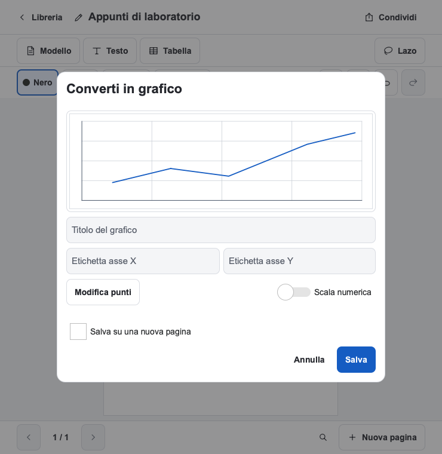

# Guida a Quaderno

[English](en/USER_GUIDE.md) · **Italiano**

Quaderno è una libreria locale per scrivere a mano, organizzare quaderni e annotare documenti. Per preparare il Mac o il Paper Pro, segui la [guida all’installazione](INSTALLAZIONE.md). Per trasferire o mettere al sicuro la libreria, consulta [Dati e backup](DATI.md).

Le [sezioni di Quaderno e lo scambio dei file](FUNZIONALITA.md) descrivono cosa puoi creare in Libri, Scrittura, Grafici e Tabelle e come riusare i contenuti tra le sezioni.

In **Impostazioni**, scegli **Italiano** o **English** sotto **Lingua dell’app**. Quaderno ricorda la scelta alla riapertura.

## Il primo quaderno

1. In **Scrittura** scegli **Nuovo Markdown**, inserisci un nome e salva. Puoi già digitare il testo o iniziare con una pagina vuota.
2. Apri **Modello** e scegli **Bianco**, **Righe**, **Quadretti**, **Puntini** o **Planner**. Il modello si applica alla pagina aperta. Le nuove pagine vuote ereditano quello corrente.
3. Scrivi con il Marker sul Paper Pro. Su Mac, fai clic e trascina nella pagina. Il pulsante con il nome della penna apre **Strumenti di scrittura**.
4. Scegli **Nuova pagina** per continuare oppure **Libreria** per tornare ai quaderni. Quaderno salva le modifiche mentre lavori.

### Usare il Marker sul Paper Pro

- Tocca con la punta del Marker per premere i pulsanti, aprire quaderni, cambiare pagina, usare le impostazioni o digitare sul tastierino del PIN.
- Sulla pagina del quaderno, scrivi con la punta usando lo strumento attivo. Usa l’estremità con la gomma, se presente, per cancellare i tratti.
- Nell’editor dei diagrammi, usa la punta per selezionare, spostare o ridimensionare le forme e per collegarle.

## Libreria e pagine

Scegli una sezione della libreria per raggiungere il contenuto che ti serve.

- **Libri** raccoglie i PDF e gli EPUB importati.
- **Scrittura** raccoglie i quaderni con testo Markdown e annotazioni a mano libera.
- **Grafici** e **Tabelle** raccolgono gli elementi modificabili già salvati nelle pagine. Scegli un elemento per aprire la sua pagina. Puoi anche creare un quaderno per un nuovo grafico o una nuova tabella dalla relativa sezione.

### Cartelle, preferiti, tag e cestino

- In **File**, usa **Nuova cartella** per creare una cartella nella posizione corrente. Apri una cartella per creare al suo interno un quaderno o una sottocartella. Il menu **…** della cartella consente di rinominarla e di eliminarla quando è vuota.
- Il menu **…** accanto a un quaderno contiene **Aggiungi ai preferiti**, **Sposta in una cartella**, **Gestisci tag**, **Duplica quaderno** e **Sposta nel cestino**.
- Usa **Preferiti** e **Tag** per filtrare i quaderni. La ricerca della libreria trova titoli, tag dei quaderni e tag delle pagine. In **File**, cerca anche nelle sottocartelle. Con **Ordina** puoi passare dall’ordine della libreria all’ordinamento alfabetico.
- Nel **Cestino** puoi ripristinare un quaderno oppure eliminarlo definitivamente dopo conferma.

### Panoramica delle pagine

Apri il contatore in basso, per esempio **2 / 5**, per vedere le miniature. Seleziona una pagina, poi usa **Apri**, **Duplica**, **Tag pagina**, **Sposta in…** o **Elimina**. Le frecce **Sposta indietro** e **Sposta avanti** cambiano l’ordine all’interno del quaderno. **Sposta in…** trasferisce la pagina selezionata in un altro quaderno.

Quando riapri un quaderno, Quaderno torna all’ultima pagina che hai consultato su quel dispositivo. La posizione segue la pagina quando la riordini.

Puoi assegnare fino a 20 tag per pagina o quaderno, con un massimo di 40 caratteri per tag. Dentro un quaderno, **Cerca testo** cerca nei blocchi digitati, nelle celle delle tabelle, nelle etichette dei grafici, nei tag di pagina, nelle trascrizioni salvate e nel testo estratto dai PDF. Su Mac puoi usare **⌘F** per aprire la ricerca.

## Scrittura e contenuti della pagina

- **Modifica Markdown** apre il testo del documento. Puoi usare la tastiera sul Mac o quella a schermo sul Paper Pro.
- **Strumenti di scrittura** offre penna, matita, pennarello, evidenziatore e gomma per tratti interi. Sono disponibili tre spessori. Con **Linea**, **Rettangolo** o **Ellisse** puoi disegnare una forma trascinando tra i suoi estremi.
- **Inserisci immagine** apre un PNG o JPEG locale. La copia incorporata si apre anche sui dispositivi che ricevono il quaderno.
- **Inserisci dalla libreria** copia un grafico o una tabella nella pagina corrente. Puoi modificare la copia indipendentemente dall’originale.
- **Testo** inserisce un blocco su più righe. Tocca un blocco esistente per aprirlo e selezionare o modificare il testo. Sul Paper Pro, quando il sistema rileva una tastiera Bluetooth o USB collegata, la tastiera a schermo si nasconde.
- Per scegliere il layout QWERTY della tastiera a schermo, tocca **IT/EN** oppure apri **Impostazioni → Dispositivo → Tastiera a schermo**. Puoi passare da **Italiano** a **English (US)** anche mentre scrivi. Quaderno ricorda il layout separatamente dalla lingua dei menu.
- **Tabella** inserisce fino a 12 righe e 8 colonne. Tocca la cella da compilare. Con la tastiera, **Tab** passa alla cella successiva e **Invio** scende di una riga.
- **Elementi** attiva la modifica di blocchi, tabelle e grafici. Tocca un elemento per aprirlo o eliminarlo dal suo editor. Trascinalo per spostarlo sulla pagina. Premi **Scrivi** per tornare alla penna.
- **Pagina intera** nasconde gli strumenti. Usa **Mostra strumenti** per ripristinare la barra.

Sul Paper Pro con firmware **3.29.1.0**, Quaderno usa la modalità rapida del pannello per l’interfaccia e mantiene quella standard per le pagine con documenti, immagini, grafici o diagrammi. **Aggiornamento automatico** chiede un ridisegno solo se la nuova pagina tarda a comparire. Puoi disattivarlo in **Impostazioni → Dispositivo → Schermo**. Per pulire eventuali immagini residue su tutto il pannello, tocca **Aggiorna schermo** nella barra in basso, anche in **Pagina intera**. La pulizia completa può far lampeggiare lo schermo.

### Creare una tabella da un CSV

Sulla pagina in cui vuoi inserire la tabella, scegli **Tabella → Importa CSV** e apri un file `.csv` o `.tsv` locale. Sul Mac puoi partire anche dalla sezione **Tabelle** della libreria e creare un quaderno per la nuova tabella. Controlla le celle nell’editor, correggile se necessario e premi **Salva**.

Quaderno legge file in UTF‑8 con colonne separate da virgole, punti e virgola o tabulazioni. Puoi importare fino a 12 righe e 8 colonne, con 500 caratteri al massimo per cella. La prima riga viene importata come tutte le altre.

Sul Paper Pro puoi scegliere un file già presente sul tablet. Se il CSV è sul Mac, puoi importarlo in Quaderno e poi [inviare il quaderno al Paper Pro](#inviare-un-quaderno-dal-mac-al-paper-pro).

Per esportare i dati, apri la tabella e scegli **Esporta CSV**. Il file include i risultati delle formule.

### Calcolare somma e media

Seleziona una cella vuota sotto i valori e premi **Somma** o **Media** per proporre un intervallo nella stessa colonna. Puoi scrivere o modificare la formula nel campo della cella. Per esempio, usa `=SOMMA(B2:B4)` in `B5` e `=MEDIA(B2:B4)` in `B6`. Funzionano anche `SUM` e `AVERAGE`. La griglia mostra il risultato o un codice di errore.

### Creare un grafico da una tabella

Per creare un grafico indipendente, apri **Grafici → Nuovo grafico** nella libreria. Puoi scegliere linee o barre, modificare i due punti iniziali e impostare il titolo e le etichette degli assi.

1. Crea e salva una tabella. Aprila da **Elementi** e scegli **Grafico**.
2. Scegli **Linee** o **Barre** e due colonne numeriche distinte per X e Y. Per i decimali puoi usare la virgola o il punto. Per un grafico a linee servono almeno due righe di dati. Per le barre, usa un valore X distinto per ciascuna riga.
3. Attiva **Prima riga come intestazione** se vuoi usare i titoli delle colonne come etichette degli assi. Controlla l’anteprima e premi **Salva**.

Il grafico usa anche i risultati numerici delle formule e si aggiorna quando salvi una modifica alla tabella. Se le colonne selezionate contengono valori incompleti o non validi, correggi le celle per ripristinare il grafico. Una copia indipendente del grafico esporta anche i valori negativi con **Copia CSV** o **Salva CSV**.

### Diagrammi di flusso

1. Apri una pagina e scegli **Diagramma**. Aggiungi le forme che ti servono oppure usa **Modello di flusso** per partire da un esempio modificabile. Da un diagramma vuoto, **Importa .drawio** apre anche i file `.xml` di draw.io. Quaderno importa la prima pagina e segnala gli elementi che ha omesso o semplificato.
2. Trascina le forme per disporle e usa il quadratino nell’angolo per ridimensionarle. **Griglia** allinea lo spostamento e il ridimensionamento ai punti della griglia. Seleziona una forma per duplicarla o per modificare la sua etichetta.
3. Con **Collega**, tocca la forma di partenza e poi quella di arrivo. Le frecce seguono le forme quando le sposti. Seleziona una freccia per aggiungere un’etichetta, invertirla o passare al percorso ad angolo retto. Puoi annullare e ripristinare le modifiche fatte nell’editor.
4. Salva il diagramma nel quaderno. Per riaprirlo, scegli **Elementi** e tocca il diagramma. L’esportazione PDF include il disegno. Dal menu **Altre azioni → Esporta .drawio** puoi salvare forme e frecce modificabili in draw.io.

Aggiorna Quaderno su Mac e Paper Pro per trasferire i diagrammi mantenendoli modificabili. Ogni diagramma può contenere fino a 64 forme e 128 collegamenti. L’importazione accetta file fino a 2 MiB.

Per sistemare più forme insieme, attiva **Lazo** e cerchia i loro centri. Trascina una delle forme selezionate per spostarle tutte. In **Allinea e distribuisci** puoi allineare due o più forme e, se c’è spazio sufficiente, lasciare lo stesso intervallo tra tre o più forme. Puoi annullare ogni spostamento o allineamento in un solo passaggio.

Usa **Ingrandisci vista** e **Riduci vista** per cambiare lo zoom. Con **Sposta vista** puoi trascinare il diagramma per raggiungere un’altra zona. Disattiva il comando per tornare a modificare le forme, oppure usa **Adatta alla vista** per rivedere tutto il diagramma.

### Livelli di inchiostro

Apri **Livelli** per aggiungere un livello o sceglierne uno esistente. La penna accanto al nome indica il livello attivo. Usa **Nascondi** o **Mostra** per controllarne la visibilità. Se il livello attivo è nascosto, rendilo visibile oppure selezionane un altro prima di scrivere.

Puoi rinominare, riordinare, unire o eliminare livelli. **Unisci sotto** richiede la stessa visibilità per i due livelli. Ogni pagina può avere fino a 12 livelli e deve conservarne almeno uno. Gomma, lazo e cronologia **Annulla** e **Ripeti** operano sui tratti del livello attivo. Nell’esportazione PDF compaiono i livelli visibili.

### Forme intelligenti e ripristino

1. Apri **Strumenti di scrittura**, attiva **Forme intelligenti** e scegli penna, matita o pennarello.
2. Disegna una linea, un rettangolo allineato alla pagina o un’ellisse. Tieni ferma la punta alla fine del tratto.
3. Quando compare la forma in anteprima, solleva la punta per confermarla. Sposta la punta per riprendere il tratto libero.
4. Per recuperare il tratto a mano, attiva **Lazo**, circonda la forma e scegli **Ripristina tratti originali**. Il ripristino è reversibile con **Annulla**.

## Selezionare e modificare i tratti

Premi **Lazo** e disegna un contorno attorno ai tratti del livello attivo. Al rilascio si apre il pannello **Tratti selezionati**.

### Spostare, ruotare e copiare i tratti

- Scegli **Sposta e trasforma** e trascina la selezione nell’anteprima con il dito sul Paper Pro o con il puntatore sul Mac. Usa **−**, **+** o i pulsanti di rotazione per modificarla. Premi **Applica** per salvare. Una selezione che contiene rettangoli o ellissi corretti con **Forme intelligenti** ruota a passi di 90° per conservare i tratti originali.
- Scegli **Copia tratti**, apri la pagina di destinazione e premi **Incolla** nella barra degli strumenti. Posiziona la copia nell’anteprima e premi **Incolla** per aggiungerla al livello attivo.
- Usa **Annulla** e **Ripeti** sulla pagina in cui hai applicato lo spostamento o l’incolla.

### Da schizzo a grafico

1. Circonda i due assi del grafico e una singola curva o una serie di barre verticali. Gli assi devono incontrarsi in basso a sinistra. Lascia fuori le scritte a mano e le serie sovrapposte.
2. Scegli **Converti in grafico**. Controlla l’anteprima e compila il titolo e le etichette degli assi.
3. Usa **Modifica punti** per correggere le coordinate percentuali di un punto. Premi **Applica punto** per confermare la modifica.
4. Per ottenere valori numerici, attiva **Scala numerica** e inserisci il valore all’estremità di ciascun asse, partendo da zero. Se l’asse X va da 0 a 12 mesi e l’asse Y da 0 a 200 euro, inserisci rispettivamente **12** e **200**. A questo punto puoi usare **Copia CSV** o **Salva CSV**.
5. Premi **Salva**. Per tenere il grafico separato dallo schizzo, seleziona **Salva su una nuova pagina**. Il grafico è vettoriale e lo schizzo originale resta nel quaderno.

### Da scrittura a mano a testo

Sul Paper Pro con il motore di trascrizione installato, cerchia una frase con **Lazo**. Quando sollevi la penna, Quaderno avvia il riconoscimento in italiano e mostra un’anteprima in **Tratti selezionati**. Sul Mac, seleziona la frase e premi **Trascrivi in italiano**. [Installazione](INSTALLAZIONE.md)

Apri **Rivedi la trascrizione** per correggere il testo. Scegli **Sostituisci sulla pagina** per inserire il testo nella posizione dei tratti trascritti. Per modificarlo in seguito, tocca il blocco con lo strumento **Penna** attivo oppure selezionalo da **Elementi**. Usa **Annulla** per ripristinare la scrittura a mano. Per conservare entrambe le versioni, scegli **Salva in una nuova pagina**. In questo caso **Cerca testo** può riportarti alla pagina manoscritta originale. Il riconoscimento avviene sul dispositivo e la precisione varia con la grafia.

## Documenti, importazione e condivisione

### Leggere e annotare PDF ed EPUB

In libreria seleziona **Importa documento**, poi scegli un PDF locale o un EPUB senza DRM a impaginazione fluida. Apri il volume da **Libri**. Quaderno usa le pagine come sfondo per le annotazioni. Gli EPUB vengono reimpaginati dal testo, con supporto per titoli, enfasi ed elenchi. Immagini, font incorporati e impaginazione editoriale restano fuori dalla copia.

Nella barra di lettura scegli **Evidenzia** e trascina sulla pagina per segnare un passaggio. Con **Sottolinea**, trascina da un’estremità all’altra per tracciare una linea orizzontale. Puoi scegliere colore e spessore dagli strumenti di scrittura. Con **Aggiungi nota**, digita e salva un blocco di testo sulla pagina. Per riaprire la nota e modificarla, scegli **Elementi** e tocca il blocco.

- Usa **+** e **−** per ingrandire o ridurre la pagina e **Adatta alla larghezza** per occupare tutta la larghezza disponibile. Tocca la percentuale per tornare alla pagina intera.
- Tocca la stella per aggiungere o rimuovere il segnalibro della pagina corrente. Apri **Segnalibri** per tornare direttamente a una pagina salvata.
- Scegli **Cerca testo** in fondo alla pagina per trovare parole nel testo incorporato del PDF. Seleziona un risultato per aprirne la pagina. La ricerca usa il testo che il PDF rende estraibile. Per cercare in un PDF importato con una versione precedente di Quaderno, importa nuovamente il file originale.

L’importazione è limitata a 150 pagine, fino a 48 MiB per il PDF o 64 MiB per l’EPUB e fino a 30 MiB per le immagini prodotte. Lo spazio occupato dalla libreria influisce sulla possibilità di importare nuovi documenti. Sul Paper Pro, usa **Salva PDF** per esportare la copia annotata. Sul Mac, scegli **Condividi → Salva PDF**. Il PDF comprende tutte le pagine, con testo, tabelle, grafici e inchiostro dei livelli visibili.

### Markdown e Obsidian

- In libreria, usa **Importa documento** e scegli un file `.md` o `.markdown`. Su Mac puoi anche trascinarlo dal Finder o scegliere **Apri con → Quaderno**. Quaderno conserva la sintassi Markdown e suddivide il testo in pagine. Per modificare il testo del documento, scegli **Modifica Markdown**.
- Su Mac e Paper Pro, apri **Markdown e Obsidian**. Per importare dal web, incolla l’URL HTTPS diretto al file, per esempio il collegamento **Raw** di un repository, e premi **Importa da URL**. L’importazione accetta testo UTF-8 fino a 256 KiB e 200 pagine.
- Dal quaderno aperto, scegli **Markdown e Obsidian → Esporta Markdown**. Quaderno salva inchiostro, grafici e immagini incorporate come file separati in una cartella accanto al Markdown, con collegamenti relativi. Per conservare i collegamenti, sposta insieme il file e la cartella. L’integrazione con Obsidian invia il testo Markdown.
- Su Mac, scegli la cartella del **Vault Obsidian** e inserisci il nome del file o un percorso relativo, per esempio `Riunioni/Verbale.md`. La sottocartella deve già esistere. **Salva nel vault** crea una nuova nota e rifiuta un nome già in uso. Dopo il salvataggio, usa **Apri in Obsidian**. [Obsidian URI](https://obsidian.md/help/uri)
- Per un sito già pubblicato, salva l’indirizzo HTTPS in **Obsidian Publish** e, se vuoi collegare una nota specifica, inserisci il suo percorso pubblicato o il permalink. **Copia collegamento** è disponibile su entrambi i dispositivi e **Apri nel browser** su Mac. La pubblicazione delle note si gestisce in Obsidian. [Obsidian Publish](https://obsidian.md/help/publish) · [Permalink](https://obsidian.md/help/publish/permalinks)

### Obsidian Sync sul Paper Pro

Obsidian Sync collega direttamente il Paper Pro al tuo vault remoto. Dopo la prima [configurazione via USB‑C](INSTALLAZIONE.md#collegare-obsidian-sync), bastano Quaderno aperto e sbloccato e una rete Wi‑Fi con accesso a Internet sul tablet.

1. In Quaderno apri **Markdown e Obsidian → Obsidian Sync** e scegli **Sincronizza ora**. Le note del vault vengono scaricate sul tablet. Seleziona una nota per aprire il quaderno collegato. Le modifiche dal cloud si applicano quando riapri la nota da questo pannello.
2. Per aggiornare la nota in Obsidian, modifica il testo da **Elementi** e salva. Torna al pannello **Obsidian Sync** e scegli **Invia modifiche** per quella nota. Il testo Markdown viene inviato al vault. Inchiostro, tabelle, grafici e altri elementi del quaderno restano in Quaderno.
3. Se Quaderno rileva una modifica incompatibile, conserva il quaderno collegato. Scegli **Importa copia dal cloud** per aprire il testo remoto in un quaderno separato. Anche i quaderni collegati a note rimosse o rinominate nel vault rimangono nella libreria di Quaderno.

Il pannello elenca fino a 3.000 note `.md` in UTF‑8, con un limite di 256 KiB e 200 pagine per nota importata. Le note scaricate occupano spazio sul tablet. Puoi consultare i quaderni già aperti anche offline. La sincronizzazione si avvia dal pannello mentre Quaderno è in uso.

### Portare i quaderni dal Paper Pro al Mac

1. Collega il Paper Pro in modalità sviluppatore al Mac con un cavo USB‑C dati e sblocca il tablet. Al primo collegamento verifica l’identità del tablet in Terminale con `ssh root@10.11.99.1`.
2. Nella libreria Mac scegli **Importa dal Paper Pro**. Inserisci le credenziali SSH del tablet nel pannello protetto se vengono richieste.
3. Controlla quanti quaderni saranno creati, aggiornati o lasciati invariati e quante copie in conflitto saranno aggiunte. L’anteprima indica anche le eventuali cartelle nuove. Scegli **Importa quaderni** per applicare l’anteprima o **Conferma** se non ci sono cambiamenti visibili. Se la libreria del Mac cambia con l’anteprima aperta, rivedila prima di confermare.
4. Apri il quaderno importato. Ripeti l’importazione quando il quaderno sul tablet cambia. Se hai modificato anche il contenuto della copia Mac, Quaderno conserva entrambe le versioni.

**Importa quaderni** consente di scegliere un file `quaderni.json` già copiato sul Mac. Il trasferimento importa la libreria di Quaderno fino a 64 MiB. I quaderni nativi reMarkable e reMarkable Connect usano un archivio separato. Consulta [Dati e backup](DATI.md) per i percorsi e le procedure di copia.

### Inviare un quaderno dal Mac al Paper Pro

1. Installa sul Paper Pro una versione di Quaderno che supporta il trasferimento USB‑C. Usa lo stesso cavo e la stessa configurazione SSH dell’importazione dal tablet. Consulta [Installazione](INSTALLAZIONE.md).
2. Apri il quaderno sul Mac e scegli **Invia al Paper Pro**. L’anteprima indica l’origine, la destinazione e l’esito previsto dell’invio. Quando le due copie differiscono, indica anche quante pagine presentano modifiche.
3. Chiudi Quaderno sul Paper Pro e scegli **Invia quaderno** sul Mac. Se il contenuto coincide, scegli **Conferma**. Riapri Quaderno sul tablet per vedere il risultato.

Ogni invio trasferisce un quaderno fino a 64 MiB. L’aggiornamento conserva la cartella, lo stato di preferito e le etichette presenti sul Paper Pro. Se le copie differiscono e Quaderno non può verificare che quella sul tablet coincida con l’ultima versione condivisa, la conserva e ne aggiunge una separata. Se il quaderno selezionato sul Mac o la libreria del Paper Pro cambia dopo l’anteprima, rivedi il trasferimento prima di inviarlo.

### Sincronizzazione wireless

Aggiorna Quaderno su entrambi i dispositivi e tieni le app aperte e sbloccate.

#### Collegare via Bluetooth

1. Sul Paper Pro vai in **Impostazioni → Bluetooth**, tocca **Apri sincronizzazione Bluetooth** e scegli **Avvia Bluetooth**. Sul firmware 3.29.1.0, Quaderno attiva il controller se necessario e mostra il codice per il primo abbinamento.
2. Sul Mac apri **Impostazioni → Rete → Apri sincronizzazione Bluetooth**. Inserisci il codice mostrato sul Paper Pro e scegli **Collega il Paper Pro**. Consenti l’accesso a Bluetooth se macOS lo richiede.

L’abbinamento collega le due app Quaderno. Dopo un riavvio del Paper Pro, usa **Avvia Bluetooth** per riattivare il collegamento.

#### Collegare via Wi-Fi locale

1. Collega entrambi i dispositivi alla stessa rete Wi-Fi. Sul Paper Pro apri **Sincronizzazione wireless** con l’icona delle due frecce, scegli **Wi-Fi locale** e lascia attivo il collegamento.
2. Sul Mac apri lo stesso pannello. Inserisci il codice e l’indirizzo IPv4 mostrati dal Paper Pro, poi scegli **Wi-Fi locale**. Consenti l’accesso alla rete locale se macOS lo richiede.

#### Sincronizzare i quaderni

1. Apri un quaderno sul dispositivo da cui vuoi inviarlo. Scegli **Anteprima invio quaderno**, controlla l’azione e premi **Conferma invio**. Il limite per quaderno è 8 MiB via Bluetooth e 64 MiB via Wi-Fi, misurati sul quaderno esportato.
2. Per inviare automaticamente le modifiche successive, attiva **Sincronizza automaticamente** e **Sincronizza questo quaderno** su ciascun dispositivo che vuoi usare come sorgente. Gli aggiornamenti automatici richiedono una versione precedente riconosciuta da entrambi. Un conflitto richiede conferma e crea una copia separata. Le eliminazioni restano locali.

Con la sincronizzazione automatica attiva, Quaderno tenta di ristabilire l’ultimo tipo di collegamento mentre le due app sono aperte e sbloccate. Per il Wi-Fi usa l’ultimo indirizzo salvato sul Mac. **Disconnetti** sospende il collegamento nella sessione corrente. **Rimuovi abbinamento** cancella il codice salvato e le preferenze di sincronizzazione per quel dispositivo.

Per continuare sull’altro dispositivo, apri la pagina e scegli **Continua sul Mac** o **Continua sul Paper Pro**. Se serve trasferire la versione corrente, Quaderno mostra prima l’anteprima. Sull’altro dispositivo scegli **Mostra richiesta → Apri pagina**. Se il quaderno è cambiato dopo l’invio o è in conflitto, verifica le due versioni e invia una nuova richiesta.

La libreria e l’editor mostrano lo stato dei quaderni già condivisi. **Ultima versione condivisa** indica che la copia locale coincide con la revisione confermata dall’altro dispositivo. **Modifiche da sincronizzare** indica che la copia locale è cambiata. Apri **Sincronizzazione wireless** per leggere i dettagli di un conflitto o errore e la data dell’ultimo scambio riuscito.

Puoi scollegare il cavo dopo aver avviato Quaderno. Per riaprire l’app dal menu del tablet, usa la voce **Quaderno** di AppLoad se configurata. La sessione USB temporanea scade dopo 10 minuti. [Avvio dal menu AppLoad](INSTALLAZIONE.md#avviare-dal-menu-appload)

### Note, Libri e iCloud sul Mac

Per importare un libro, scegli **Importa da Apple Books** dalla libreria di Quaderno sul Mac. **Apri Apple Books** apre Libri. Torna in Quaderno e scegli **Scegli PDF o EPUB…** per selezionare una copia locale senza DRM. Se apri un PDF di Libri in Anteprima, puoi salvarne una copia con **File → Esporta**. Puoi selezionare anche i pacchetti `.epub` che Finder mostra come un singolo libro. L’accesso alla libreria nel cloud e ai titoli protetti del Book Store resta in Apple Books. [PDF in Libri](https://support.apple.com/it-it/guide/books/ibkseed72068/mac) · [Esportare un PDF da Anteprima](https://support.apple.com/it-it/guide/preview/prvw0e8da223/mac)

Dopo l’importazione apri il libro in Quaderno. Da **Sincronizzazione wireless**, scegli **Anteprima invio quaderno**, controlla la destinazione e conferma l’invio. Il limite riguarda il quaderno preparato per il trasferimento, che comprende le immagini delle pagine e le annotazioni. Se supera 8 MiB via Bluetooth, usa **Wi-Fi locale**, che accetta fino a 64 MiB. [Sincronizzazione wireless](#sincronizzazione-wireless)

Trascina un PDF o EPUB senza DRM dal Finder alla finestra di Quaderno per importarlo. Puoi anche scegliere **Apri con → Quaderno** dal Finder. Dal quaderno aperto scegli **Condividi**, poi trascina **Pagina corrente** o **Intero quaderno** in una cartella del Finder per ottenere un PDF.

- Per allegare il quaderno in **Note**, usa **Condividi → Condividi PDF** e seleziona **Note** nel menu di macOS, se disponibile. Puoi scegliere una nota nuova o esistente. Puoi anche salvare il PDF e condividerlo da Finder. [Condividere un file in Note](https://support.apple.com/it-it/102223)
- Per aggiungerlo a **Libri**, scegli **Condividi → Salva PDF**. In Libri apri **File → Importa** e seleziona il PDF. [Importare PDF in Libri](https://support.apple.com/en-am/guide/books/ibkseed72068/mac)
- Per conservare una copia su **iCloud Drive**, scegli quella cartella nel pannello di salvataggio. La sincronizzazione delle copie in Note o Libri dipende dalle impostazioni iCloud di Apple. Le modifiche alle copie si fanno nelle rispettive app. [Note con iCloud](https://support.apple.com/it-it/guide/icloud/-mm2d069f7097/icloud) · [Libri con iCloud](https://support.apple.com/it-it/guide/icloud/mm3941ae3362/icloud)

## Impostazioni

Apri **Impostazioni** dalla libreria.

- In **Rete**, **Wi‑Fi** sul Paper Pro cerca le reti e usa il servizio del sistema per collegarsi a reti aperte o WPA/WPA2 personali. Quaderno passa la password al servizio per la connessione. Sul Mac, **Apri sincronizzazione Bluetooth** avvia l’[abbinamento tra le due app](#collegare-via-bluetooth).
- Sul Paper Pro con firmware **3.29.1.0**, **Bluetooth** gestisce gli [accessori nelle vicinanze](#collegare-una-tastiera-bluetooth) e la sincronizzazione Quaderno.
- In **USB‑C**, premi **Verifica** per controllare se il servizio SSH risponde a `10.11.99.1:22`. Sul Mac trovi anche **Copia comando** e, quando disponibile, **Apri in Terminale**.
- In **Sicurezza**, **PIN di Quaderno** imposta un PIN da 4 a 8 cifre. Puoi cambiarlo, rimuoverlo oppure usare **Blocca ora**. Con il PIN attivo, Quaderno si blocca all’apertura e dopo 1, 5 o 15 minuti di inattività. Il valore iniziale è 5 minuti. Il sistema operativo gestisce lo sblocco del dispositivo e l’accesso ai file.
- **Dispositivo** mostra modello, versione software e stato della batteria se rilevabili. Sul Paper Pro, **Luce di lettura** regola la luminosità per la sessione corrente quando il driver espone i controlli richiesti.

### Collegare una tastiera Bluetooth

1. Metti la tastiera in modalità di abbinamento.
2. Sul Paper Pro, apri **Impostazioni → Bluetooth**, attiva il Bluetooth e tocca **Cerca dispositivi**.
3. Accanto alla tastiera, scegli **Abbina**. Se Quaderno mostra un codice da digitare sulla tastiera, scrivilo sulla tastiera fisica e premi **Invio**. Per gli altri tipi di codice, segui le indicazioni sullo schermo.
4. Quando la tastiera è collegata, apri un campo di testo, un documento Markdown o una cella per scrivere. Nelle impostazioni Bluetooth puoi anche riconnettere, disconnettere o dissociare gli accessori.

Il Paper Pro usa i profili Bluetooth supportati dal firmware. Le tastiere Bluetooth con profilo HID usano l’input del sistema.
