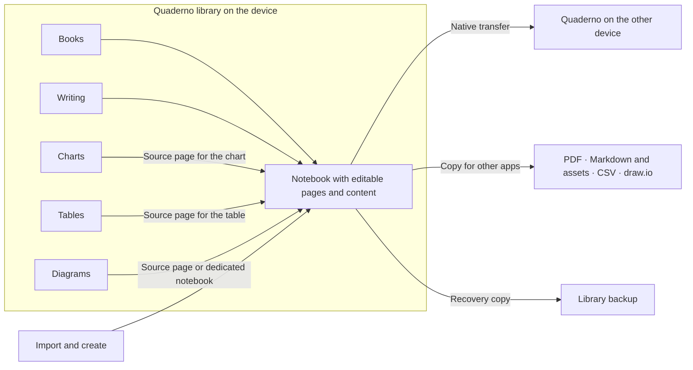
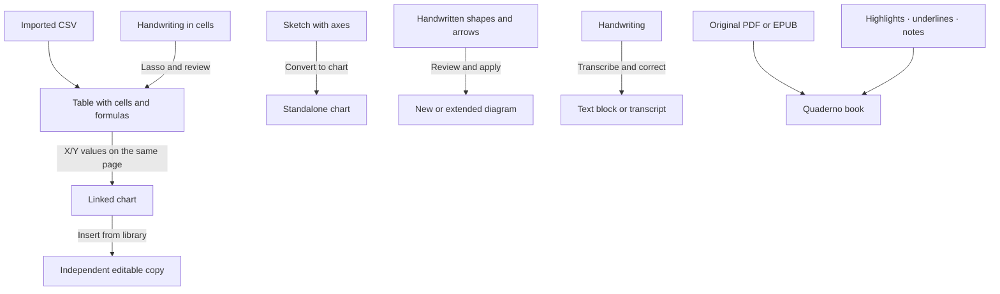

# Quaderno functions and workflows

[Italiano](../FUNZIONI_E_FLUSSI.md) · **English**

Keep and transfer the saved Quaderno notebook when you want to continue editing it. The five sections help you find different kinds of content in the same library. This map includes the **0.2.12 development interface** and identifies functions that depend on Mac, Paper Pro, firmware or external accounts.

[Structure](#how-work-is-organized) · [Sections](#the-five-sections) · [Shared tools](#shared-tools-and-gestures) · [Content workflows](#how-content-works-together) · [Devices and services](#devices-and-services) · [Storage and verification](#storage-and-verification)

## How work is organized

| Level | What it contains | Effect of actions |
| --- | --- | --- |
| Library | Notebooks, folders, favorites, tags and Trash. Search by name or tag, filter by section or format and sort by title or page count where available. | Moving a notebook to a folder changes its location. Trash lets you restore it until you delete it permanently. |
| Notebook | Title, ordered pages, any imported source or Markdown, handwriting recognition language and bookmarks. | Opening an entry in Charts, Tables or Diagrams takes you to its source page. Open the editor with a separate action. |
| Page | PDF/EPUB background or paper template, ink layers, tags and positioned objects. | In **Pages**, filter by bookmarks or annotations, jump to a number, duplicate, reorder, delete or move a page. Text search opens the page of a result. |
| Object | Text block, image, table, chart, diagram or sticky note. | Editing the object on the page updates the original. **From library** inserts an independent copy of a chart, table or diagram. A table and its linked chart share data on the same page. |
| View | Open page, zoom, margins, orientation and local reading preferences. | Changing the view leaves the notebook revision intact. **Continue** can ask the other device to open a page matching the received revision. |

## The five sections

The section toolbar shows two or three primary actions, depending on the available space, and puts the others under **More**. An action with one compatible object on the page opens it directly. Choose the target when several objects are available.

**Import CSV** in Tables and **Import draw.io** in Diagrams open the file picker first. Confirming the file opens its editor with a draft. Cancel returns to the sheet. If the page changes while the picker is open, the file is not applied to the new page.

### Books

| Action | Workflow and result |
| --- | --- |
| Import | Open a local PDF or a DRM-free reflowable EPUB. On Mac you can also open or drag files from Finder, import batches with a report, and choose local copies from Apple Books. Quaderno keeps the original PDF or EPUB, prepares it in the background and renders pages on demand. |
| Read | Use zoom, fit page or width, page overview, previous/next page and bookmarks. **Find text** uses extractable PDF text and text saved in annotations. The PDF reader cannot search a scan that has no text layer. |
| Annotate | **Highlight** and **Underline** store editable strokes on the active layer. **Sticky note** asks you to choose a point on the page and saves a numbered marker with typed text, handwriting or both. Tap the marker to reopen it. Typed text is searchable. Move the marker using **Items**. Its position follows zoom and rotation. |
| Find and send | **Annotated pages** includes pages with hidden-layer strokes. **Sync book** opens a native transfer workflow for all pages and annotations. Importing the same source on both devices separately creates two independent notebook identities. |
| Share | An annotated PDF shows visible layers and objects. It includes sticky-note markers on the pages and appendices with paginated text and handwriting. A current-page export includes only notes from that page. |

A source PDF may be up to 48 MiB and an EPUB up to 64 MiB. The prepared PDF from an EPUB must fit within 48 MiB. Support for styles and resources depends on the document. Import, storage and transfer limits apply separately. [Reading](USER_GUIDE.md#read-and-annotate-pdfs-and-epubs) · [Sticky notes](BOOK_NOTES.md)

### Writing

| Action | Workflow and result |
| --- | --- |
| Create and annotate | Create a notebook, choose a paper template and write on a visible layer. Add separate text blocks and supported local images. Move objects through **Items** or select mixed content with the lasso. |
| Write Markdown | Create a document, import a UTF-8 file or use a direct HTTPS URL. **Edit Markdown** changes the source and redistributes its text across pages. Objects and ink stay separate from the source. Imported text is limited to 256 KiB and 200 pages. |
| Reuse objects | **From library** adds an editable copy of a chart, table or diagram. You can also create these objects directly on a page and find them in their own section. |
| Share | PDF preserves appearance. Markdown exports text and can add images, ink and charts as image assets. Diagrams also get a `.drawio` attachment. Transfer the notebook to keep editing its native content. |

[Writing and page content](USER_GUIDE.md#writing-and-page-content) · [Markdown and Obsidian](USER_GUIDE.md#markdown-and-obsidian)

### Charts

| Workflow | Data and relationships |
| --- | --- |
| Standalone points | Create a line or bar chart. Edit the title, labels, points and scale. A chart can have up to 128 points. Lines need at least two points. Bars need at least one point and distinct X values. |
| From a table | Choose two numeric columns from a table on the same page and optionally use the first row for headers. Save to link the table. Numeric formula results can also feed the chart. Saving subsequent table changes updates the chart. |
| From a sketch | Use the lasso to select compatible axes and one curve or set of bars. **Convert to chart** lets you correct points, calibrate axes and choose where to save. The original sketch stays in the notebook. |
| Reuse and export | Tap the chart or choose **Edit data** to open the appropriate editor. Copying a linked chart captures its current valid values and creates a standalone chart. CSV exposes calibrated data, including negative values when present. |

[Charts](FEATURES.md#charts) · [Charts from tables](USER_GUIDE.md#create-a-chart-from-a-table)

### Tables

| Action | Workflow and result |
| --- | --- |
| Create and import | Add a blank grid or import a UTF-8 CSV or TSV up to 256 KiB. The first row remains editable. The grid holds up to 12 rows, 8 columns and 500 characters per cell. |
| Edit | Tap a cell or choose **Cells and formulas**. The input field exposes the original formula, and the grid displays the result. Use **Tab**, **Shift+Tab** and **Enter** to navigate the cells. Shrinking a grid with data loss requires confirmation. |
| Calculate | Use references such as `A1` and ranges such as `A1:B3`. Available functions include `SUM`/`SOMMA`, `AVERAGE`/`MEDIA`, `MIN`, `MAX` and `COUNT`/`CONTA.NUMERI`. The editor explains errors in the selected cell. |
| Capture handwritten values | Write within the cells, select the strokes and choose **Insert into cells**. Review the result and destination for each cell. Replacing existing values or formulas needs explicit consent. Excluded or unassigned strokes stay on the page. |
| Use the results | **Create chart** links two columns. **Export CSV** writes values and formula results. The editable formulas and chart link travel with the native notebook. |

[Tables and CSV](FEATURES.md#tables) · [Handwriting in cells](LASSO.md)

### Diagrams

| Action | Workflow and result |
| --- | --- |
| Create and arrange | A dedicated diagram notebook is available even when empty. The editor lets you insert shapes, connect nodes with arrows, edit labels and routes, move, resize, align and distribute items, zoom and pan. |
| Recognize a sketch | **Recognize diagram** or the lasso opens a review of nodes and arrows. In dedicated diagram notebooks you can enable a suggestion after a pause. Geometry is recognized locally and labels use the available handwriting engine. Review labels, destination and ink retention before applying. |
| Extend | Draw new shapes or arrows around an existing diagram. The review shows the complete result and preserves existing geometry and labels. Choose the destination when more than one is possible. Strokes with uncertain direction or attachment stay as ink. Recovering recognized ink is a separate action from **Undo**. |
| Import and share | Import a supported `.drawio` or `.xml` file and review any warnings. Export `.drawio` for editing supported objects. Markdown with assets includes a PNG preview and `.drawio`. The Quaderno notebook keeps the object and its stored recovery data. |

A diagram supports 64 shapes and 128 connectors. Numeric charts and flowcharts have separate recognition actions. [Diagrams, recognition and recovery](DIAGRAMS.md)

## Shared tools and gestures

| Input | Effect on the page |
| --- | --- |
| Pen, pencil and marker | Write on the active visible layer. Set color, thickness, pressure and palm rejection separately. The eraser acts on the active ink layer. Highlighting and underlining are separate tools. |
| Smart shapes | Pause at the end of a stroke to review a line, rectangle or ellipse. You can recover the original stroke. Recognition of a complete flowchart has its own action. |
| Lasso and Items | The lasso selects strokes on the active layer and page objects. Choose touched or contained items and add to or subtract from the selection. Move, rotate, resize or delete the selection, or copy and paste strokes. **Items** provides access to objects for editing and moving them directly. |
| Handwriting conversion | Local recognition proposes Italian or English text according to the available engine and dictionary. Correct it and insert it on the page, or save it on a new page. Cells in an existing table can also be the destination. |
| Touch and pen | A finger or mouse opens a cell even when empty. A brief pen tap opens a filled cell and leaves empty cells available for handwriting. With a compatible writing tool and the lasso closed, a brief tap can open charts and diagrams. Move the pen tip to annotate. |
| Two-finger gestures | Pinch from 100% to 300% and move both fingers together to pan, including on writing sheets. Tap the percentage shown on a zoomed sheet to fit it to the view. The sheet gesture changes the view only. |
| One-finger reading gestures | On pages with a document background, double tap uses the configured zoom, full-screen, refresh or no-action setting. Drag to pan a zoomed page. A swipe can turn the page horizontally or at the vertical edges according to the reading settings. |
| Undo, redo and keyboard | Edit history applies to the current page and layer session. A backup and recovery of embedded original strokes have separate workflows. On Mac, standard shortcuts support Find and Undo. On the tablet, the on-screen keyboard and recognized accessories use the applicable language and keyboard settings. |

While drawing, using the lasso, placing a sticky note or using a dialog, reading gestures yield to the active task. PIN lock and standby pause interaction. On-screen controls also provide navigation. [Lasso](LASSO.md) · [Input settings](SETTINGS.md)

## How content works together

| When you want to… | Choose… | Result |
| --- | --- | --- |
| Continue on the other device | Quaderno send or sync, USB-C, or a compatible `.quaderno` file. | Editable sources, pages, ink and layers, notes, formulas, images, charts and diagrams. Same-page chart links to tables are preserved. |
| Reuse a single object | Insert from library. | An independent object. Copying a linked chart captures its current values. To make a new live link, copy the table and generate a chart on the target page. |
| Move a complete page | **Pages → Move to…** | The page with annotations and its internal relationships, including a table–chart link. |
| Share a document for reading | PDF of the current page or entire notebook. | A visual copy. Objects and visible annotation layers appear as PDF content. |
| Take text into a vault or editor | Markdown, with an optional assets directory. | Text and linked files. Keep the file and assets directory together. Importing back into Quaderno retrieves text and links. |
| Exchange data with a spreadsheet | Table or chart CSV. | Values and columns. Table CSV contains formula results. The native table keeps its formulas. |
| Continue a diagram in draw.io | `.drawio` file. | Compatible shapes, labels and connectors. Page annotations and recovery data stay in Quaderno. |

## Devices and services

### Quaderno to Quaderno

| Method | How it interacts with the library |
| --- | --- |
| Wireless preview | Connect both open, unlocked apps using local Wi-Fi or Bluetooth LE. Open the source notebook, prepare the preview and confirm the first send. **Last shared version**, **Changes to sync** and **Conflict** describe how the current notebook relates to the last confirmed transfer. |
| Automation | Enable automation and select each notebook on each source device. Choose manual, **After changes**, on open or an interval of 5, 15, 30 or 60 minutes. After changes waits for a pause in editing. On open does not trigger for every annotation added while the book stays open. |
| Automatic transport | Prefer local Wi-Fi and fall back to paired Bluetooth that is already on, or choose a single transport. Trusted SSIDs restrict Wi-Fi. The charging requirement on Paper Pro applies to both. Mac reuses the last configured IPv4 address. **Disconnect** pauses automatic reconnect. |
| Interruptions and conflicts | Incremental transfer reuses saved objects and chunks and supports notebooks up to 64 MiB. After an interruption it prepares a fresh preview. Uncertain outcomes and conflicts can require review. **Keep both copies** creates a separate notebook. Deletions and reading preferences stay local. |
| USB-C and native files | Mac can transfer over USB-C/SSH. Sending over USB opens a preview and requires Quaderno to be closed on the tablet while the update is applied. A portable file is self-contained. The internal `quaderni.json` index on its own is incomplete. |

The receiver must support the format required by the content. Sticky notes use format **11** and some extended diagrams use **10**. Wireless negotiation uses a conservative limit when an older app does not advertise support. Use updated apps on both devices for these contents. Native sync runs over a local network or Bluetooth and matches the same notebooks. [Protocol and compatibility](SYNC_PROTOCOL.md) · [USB-C transfer](USER_GUIDE.md)

### Apple, Obsidian and cloud accounts

| Destination | Quaderno workflow | Requirements and scope |
| --- | --- | --- |
| Apple Books | On Mac, open Books, choose a compatible local copy and import it into Quaderno. To go the other way, prepare an annotated PDF and import it into Books. | Apple Books manages protected titles and its iCloud library. Native annotations sync between Quaderno apps. |
| Apple Notes and iCloud Drive | On Mac, share a PDF using the system menu when Notes is available. Assisted delivery to Notes can also prepare Markdown and assets for you to import. Choose an iCloud Drive folder in the file dialog to put a copy there. | The Apple queue prepares and reopens the copy and records your confirmation. On Paper Pro, use **Continue on Mac** through Quaderno. |
| Numbers, Keynote and Journal | Numbers receives CSV from a table on the page. Keynote receives a PDF for you to import. Journal uses the system PDF sharing flow. | These workflows use Mac and the available app or sharing destination. Keep the notebook for editable formulas, strokes and objects. |
| Local Obsidian and Publish | On Mac, save a new note to a selected vault and open it in Obsidian. Both devices can keep and copy a HTTPS Publish link. | The link points to an existing published resource. Publishing is managed in Obsidian. |
| Obsidian Sync | On a configured Paper Pro, the dialog exchanges Markdown with the vault through the CLI and an enabled account. Open a linked note or explicitly send changes. | Review conflicts. Strokes, tables, charts and diagrams stay in the notebook. |
| Google Drive, Dropbox and OneDrive | Browse folders, download and import supported formats, or upload a new copy. Sign-in uses the provider and requires project-owned OAuth registrations. The tablet may use the Mac assistant for the browser and SSH authorization. | Transfers are manual, up to 100 MiB per file or 64 MiB per notebook, subject to each importer's limits. Project builds omit production credentials. Sign-in with real accounts requires separate validation. |

[Apple sharing](USER_GUIDE.md#notes-books-and-icloud-on-mac) · [Obsidian Sync](INSTALLATION.md#connect-obsidian-sync) · [Cloud account setup](CLOUD_ACCOUNTS.md)

### Device controls

| Setting | Relationship to the work |
| --- | --- |
| Display and orientation | Reading, Writing and Drawing profiles, toolbar layout, handedness, interface scale, contrast, Quick controls and full screen change the interface. On Paper Pro, manual rotation or a supported sensor remaps input coordinates. A fixed orientation for the book takes precedence. |
| Refresh and reading light | On Paper Pro, manual refresh works even with automatic refresh off. Profiles choose the e-ink refresh strategy. Where exposed by the device, reading light applies to the current session. |
| Battery and standby | The tablet can show battery telemetry for the device and Marker where available. The standby timer can defer while charging. The PIN timeout follows its own rules. |
| Accessories | On supported Paper Pro firmware, Bluetooth keyboard pairing is separate from pairing two Quaderno apps. A detected physical keyboard can hide the on-screen one. Italian/English interface, IT/US QWERTY layout and OCR language are separate settings. |
| Network and access | The tablet exposes Wi-Fi and Bluetooth settings where supported. On Mac the system handles networking. The PIN protects the Quaderno session. Locking stops active sensitive operations. |

[Settings, devices and accessibility](SETTINGS.md)

## Storage and verification

- **Local storage.** Quaderno saves the index and page objects, keeps original data and rebuilds the reading cache from those originals. Book preferences, credentials, PIN and pairing state follow separate rules. To copy the full data folder, keep the index, its objects and recovery files together. [Data and privacy](DATA.md)
- **Managed backups.** Create a backup immediately or schedule it while Quaderno is open. It includes the library and, separately, any local reading preferences. Cache cleanup preserves original documents and annotations. A tablet backup stays on the tablet until you copy it elsewhere. [Library maintenance](LIBRARY_MAINTENANCE.md)
- **Recorded verification.** Version 0.2.11 was built and tested on Mac and ARM and launched through AppLoad on Paper Pro. The library export matched before and after the update. Tests for notes, gestures and transfers include simulated input and synthetic notebooks. Physical pen, radio and cloud sign-in checks are tracked separately. The 0.2.11 Mac package was verified separately from the existing Mac installation. [Verification history](../../CHANGELOG.md)
- **0.2.12 interface.** The new actions and gestures are part of the development version. The recorded installation on the physical device is 0.2.11, and Mac trackpad verification uses synthetic events. Sticky notes continue to use format 11.

## Guidelines for simplifying the interface

Put the section’s frequent actions close to the page. Open the editor directly when an action has a single target. Ask which table, chart or diagram to use when several are present. Move less common actions to secondary controls and keep confirmations, recovery and sync status easy to find.

Use gestures for viewing and navigating the document. Distinguish finger and pen input and respect rotation and interactive controls. While drawing, selecting or reviewing changes, keep the current work easy to finish or cancel. Provide a visible equivalent for gestures that also works with mouse and keyboard.
