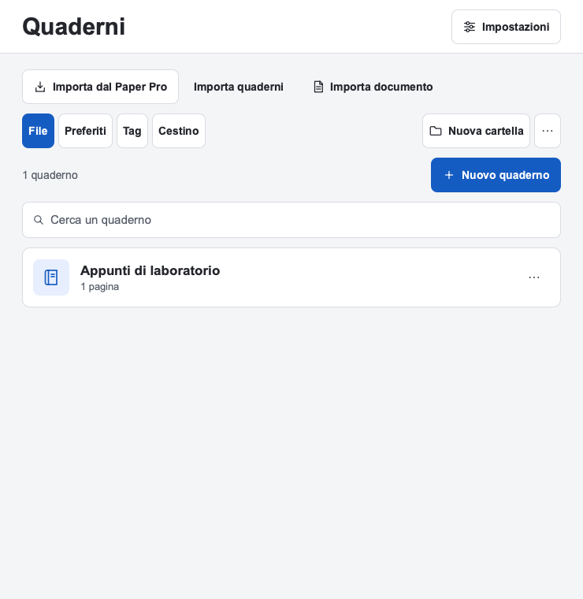
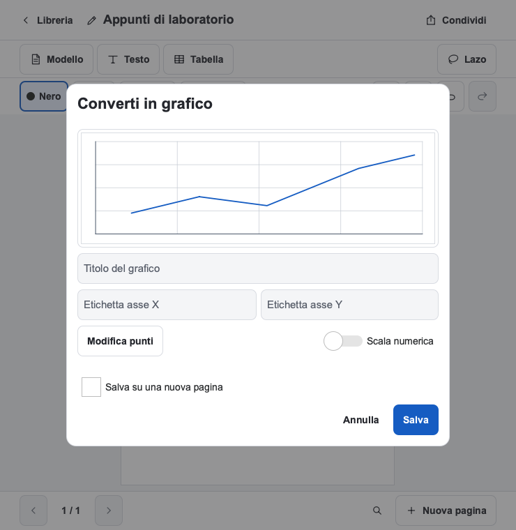

# Quaderno user guide

**English** · [Italiano](../GUIDA.md)

Quaderno stores your notebooks locally and lets you write by hand, organize notes, and annotate documents. Set up your Mac or Paper Pro with the [installation guide](INSTALLATION.md). For transfers and backups, see [Data and backups](DATA.md).

[Sections and file workflows](FEATURES.md) explains what you can create in Books, Writing, Charts, Tables, and Diagrams and how to reuse content across sections.

To use the labels in this guide, open **Impostazioni → Lingua e tastiera** (Settings → Language and keyboard) in the library and select **English** under **Lingua dell’app** (App language). Quaderno remembers your choice when you reopen it. The [0.2.6 settings guide](SETTINGS.md) describes the updated navigation and its verification status.

## Create your first notebook

1. In **Writing**, choose **New Markdown document**, enter a name, and save. Type your text or start with a blank page.
2. Open **Template** and choose **Blank**, **Lined**, **Grid**, **Dotted**, or **Planner**. The template applies to the open page. New blank pages use the current page’s template.
3. Write with the Marker on Paper Pro, or click and drag on your Mac. Select the button that displays the current tool name to open **Writing tools**.
4. Choose **New page** to continue, or **Library** to return to your notebooks. Quaderno saves changes as you work.

### Use the Marker on Paper Pro

- Tap with the Marker tip to press buttons, open notebooks, turn pages, use settings, or enter digits on the PIN keypad.
- On a notebook page, write with the tip using the active tool. Use the eraser end, if your Marker has one, to erase strokes.
- In the diagram editor, use the tip to select, move, resize, or connect shapes.

## Library and pages

Choose a section to find what you need in the library.

- **Books** contains imported PDFs and EPUBs.
- **Writing** contains notebooks with Markdown text and freehand ink.
- **Diagrams** lists editable diagrams and blank diagram notebooks. Choose **New diagram** to open a page for drawing; opening an existing entry shows its source page without automatically opening the editor. Tap a saved diagram to edit it, or use **Items**. This fifth section is part of 0.2.8 in development; see [Diagrams](DIAGRAMS.md).
- **Charts** and **Tables** list editable items saved on notebook pages. Choose an item to open its page. The fix in development for **0.2.4** prevents the editor from opening automatically during this navigation: tap a table cell to edit it, or enable **Items** and tap a chart. Version 0.2.4 passed builds, six suites, and rendered startups on Mac and with the ARM SDK. It was installed on Paper Pro over USB on November 18, 2026, with native startup, backups, and notebook integrity verified; the installed Mac 0.2.0 app remains unchanged. That day, the user confirmed on Paper Pro that opening existing items from Tables and Charts shows the page without opening the editor. See the [validation status](LASSO.md#open-tables-and-charts-from-the-library). You can also start a notebook for a new chart or table from its section.

### Folders, favorites, tags, and trash

- In **Files**, choose **New folder** to create a folder in the current location. Open a folder to create a notebook or subfolder inside it. Use the folder’s **…** menu to rename it or delete it once it is empty.
- The **…** menu next to a notebook lets you add it to favorites, move it to a folder, manage its tags, duplicate it, or move it to the trash.
- Use **Favorites** and **Tags** to filter notebooks. Library search matches titles, notebook tags, and page tags. In **Files**, it also searches subfolders. Use **Sort** to switch between library order and alphabetical order.
- In **Trash**, you can restore a notebook or confirm its permanent deletion.

### Page overview

Select the page counter at the bottom, such as **2 / 5**, to see thumbnails. Select a page, then choose **Open**, **Duplicate**, **Page tags**, **Move to…**, or **Delete**. The **Move earlier** and **Move later** arrows reorder pages in the current notebook. **Move to…** transfers the selected page to another notebook.

When you reopen a notebook, Quaderno returns to the last page you viewed on that device. The position follows the page if you reorder it.

You can add up to 20 tags to each page or notebook. Each tag can contain up to 40 characters. Inside a notebook, **Find text** searches typed text blocks, table cells, chart labels, page tags, saved transcripts, and text extracted from PDFs. On Mac, press **⌘F** to open search.

## Writing and page content

- **Edit Markdown** opens the document’s text. Use the Mac keyboard or the Paper Pro’s on-screen keyboard.
- **Writing tools** includes a pen, pencil, marker, highlighter, and whole-stroke eraser. Choose from three stroke widths. Select **Line**, **Rectangle**, or **Ellipse** and drag between the shape’s endpoints.
- **Insert image** opens a local PNG or JPEG. The embedded copy opens on devices that receive the notebook.
- **Insert from library** copies a chart or table to the current page. You can edit the copy independently.
- **Text** inserts a multiline text block. Tap an existing block to open it and select or edit its text. On Paper Pro, the on-screen keyboard hides when the system detects a connected Bluetooth or USB keyboard.
- To choose the QWERTY layout for the on-screen keyboard, tap **IT/EN** or open **Settings → Language and keyboard → On-screen keyboard**. Switch between **Italiano** and **English (US)** as you type. Quaderno remembers the layout separately from the menu language.
- **Table** inserts a table of up to 12 rows and 8 columns. In the editor, tap a cell in the grid, edit the **Cell text** field, and choose **Save**. Press **Tab** to move to the next cell or **Enter** to move down a row.
- **Items** lets you edit text blocks, tables, and charts. Tap an item to open its editor, where you can also delete it. Drag an item to move it on the page. Choose **Write** to return to pen input.
- **Full page** hides the tools. Choose **Show tools** to restore the toolbar.

On Paper Pro with firmware **3.29.1.0**, Quaderno uses the panel’s fast mode for the interface and the standard mode for pages with documents, images, charts, or diagrams. **Automatic refresh** requests a redraw only when the new page is slow to appear. You can turn it off in **Settings → Display**. To clear residual images across the whole panel, tap **Refresh screen** in the bottom bar, including in **Full page** view. The 0.2.6 settings also expose manual refresh under **General** and **Display**. A full refresh can make the display flash.

### Recognize a mixed page on Paper Pro

In Quaderno 0.2.17, you can extract a flowchart, a table and text from one page into a single notebook. The tablet runs the analysis and handwriting recognition locally, including offline.

1. Open the handwritten page in **Writing** or the imported PDF page in **Books**. Choose **More → Recognize mixed page**.
2. Choose **Diagram**, **Table** or **Text**, then use the Marker to draw around the corresponding content in the preview. Quaderno closes the outline when you lift the pen. Use several outlines for a part spread across the page. After marking all three parts, choose **Recognize**.
3. Compare each draft with the source preview. Check the diagram’s shapes, arrows and labels, then correct them in the diagram editor. Check the table’s rows and cells. Use one line per row and a tab or `|` between columns. Correct or complete the text in the **Text** tab.
4. Enter a title and choose **Create notebook**. Quaderno opens the result in **Writing**. The Markdown goes on the opening pages, followed by a page for the editable diagram and a page for the editable table. The first page links to both. The source page remains available with its original contents.

Quaderno can use the original pen strokes to recognize shapes on a handwritten notebook page. On an imported PDF it analyzes the rendered page, where handwriting and arrows can be harder to distinguish. A draft may miss shapes, links, words or column boundaries. You can fill in a draft during review, including when a local recognizer is unavailable.

With the optional image OCR helper in 0.2.18, the **Text** area uses a local Latin-script model for rendered PDFs and images. In the review, compare the text with the source page, especially web addresses, file paths, names and punctuation. [Install the optional OCR helper](INSTALLATION.md#install-and-start-quaderno)

Since 0.2.19, the same helper reads the **Table** area. For a ruled table, draw one outline around the whole grid, including the outside edges. A clearly recognized grid can place each value in its cell, including gaps for empty cells. For layouts with a single column, missing borders or an ambiguous grid, check the proposed rows and separate columns with Tab or `|`. Use two consecutive separators for an empty cell between values. Check row and column alignment, especially for text that crosses a divider. Quaderno saves an editable table of up to 12 rows and 8 columns.

Since 0.2.19, the helper also proposes labels for recognized diagram shapes in PDFs and images. Check the labels against the source page and edit them alongside the shapes and arrows before saving.

### Open linked items from Writing

Select **Linked items** to preview the referenced diagram or table. **Open** shows the original page, and **Edit** opens the object in its editor. You can also tap a link marker to go straight to the original page. Use **Back to page** to return to the text. To link an existing object manually, choose **Link an item**.

Use Quaderno 0.2.17 or later on both devices for the same editing controls. Sync or export the converted notebook once to carry the Markdown, diagram, table and their links together. For a link to a different notebook, sync its destination separately. This also applies to conversions saved as three notebooks in 0.2.16. [Sync notebooks](#sync-notebooks)

### Edit a cell on the page

In 0.2.2, enable **Items**, tap the table, and select a cell in the editor grid. The fix in development for **0.2.3** lets you open a cell by tapping it directly on the page: finger taps and mouse clicks also work on empty cells; a brief pen/Marker tap opens an occupied cell. In empty cells, the pen continues writing, including single dots. Moving or holding the pen continues writing in occupied cells too. In Items mode, a tap opens the editor at the selected row and column.

Edit the **Cell text** field, then choose **Save**. For formulas, the field shows the original editable expression and the grid shows the result. Converting handwriting with the lasso produces the same editable cells. Version 0.2.3 passed builds, six test suites, and startup checks on Mac and with the ARM SDK. It was installed over USB and started on Paper Pro on November 18, 2026, with backups and notebook integrity verified; the installed Mac 0.2.0 app remains unchanged. That day, the user confirmed opening the editor with finger and pen taps and correct editing and formula recalculation in the **QA Celle 0.2.2** test scenario. For the full procedure, test values, and validation scope, see the [lasso guide](LASSO.md#edit-a-table-cell-after-conversion).

### Create a table from a CSV file

On the page where you want the table, choose **Table → Import CSV** and open a local `.csv` or `.tsv` file. On Mac, you can also start from **Tables** in the library and create a notebook for the new table. Review and edit the cells, then choose **Save**.

Quaderno reads UTF‑8 files with comma, semicolon, or tab separators. You can import up to 12 rows and 8 columns, with a maximum of 500 characters per cell. The first row is imported like any other row.

On Paper Pro, choose a file already on the tablet. If the CSV is on your Mac, import it in Quaderno and then [send the notebook to Paper Pro](#send-a-notebook-from-mac-to-paper-pro).

To export the data, open the table and choose **Export CSV**. The file includes formula results.

### Calculate totals and averages

Select an empty cell below the data and choose **Sum** or **Average** to suggest a range in that column. Type or edit the formula in the cell field. For example, enter `=SUM(B2:B4)` in `B5` and `=AVERAGE(B2:B4)` in `B6`. `SOMMA` and `MEDIA` also work. The grid displays the result or an error code.

### Create a chart from a table

To start a standalone chart, choose **Charts → New chart** in the library. Choose lines or bars, edit the two starting points, and enter a title and axis labels.

1. Create and save a table with at least two columns. Tap a cell directly with your finger to open the editor; you can also enable **Items** and tap the table.
2. Choose **Chart**. This saves the current table draft before opening the chart settings. Choosing **Cancel** in the chart dialog does not undo that table save.
3. Choose **Line** or **Bar** and select two different numeric columns for X and Y. Use a comma or a period as the decimal separator. A line chart requires at least two rows of data. For bars, use a different X value in each row.
4. Leave **Use first row as headers** enabled only if the first row contains column headings to use as axis labels. This option starts enabled: turn it off if the first row already contains numeric data so those values are included.
5. Review the preview and choose **Save** to add the linked chart to the same page.

The chart also uses numeric formula results and updates when you save changes to the table. If the selected columns contain incomplete or invalid values, correct the cells to restore the chart. An independent copy of the chart exports negative values through **Copy CSV** or **Save CSV**.

### Edit a chart with a tap

In **0.2.5** in development, open the editor by tapping the chart directly on the page with a finger, clicking with a mouse, or briefly tapping with the pen/Marker. A standalone chart opens its properties; a table-linked chart opens its settings and source-column selection, retaining its link when you save.

Direct taps are intended for the pen, pencil, or marker tool with the lasso closed. Moving or holding the pen continues writing. Lasso, eraser, highlighter, and shape tools keep their existing behavior. You can still enable **Items** to edit or drag objects. Opening an entry from the Charts library still shows only the page, as in 0.2.4.

Version 0.2.5 passed builds, all six suites, and rendered startups on Mac and with the ARM SDK, including eight new chart cases and the 0.2.4 navigation regressions. It was installed on Paper Pro over USB on November 18, 2026, with native startup, execution through AppLoad, backups, and notebook integrity verified; the installed Mac 0.2.0 app remains unchanged. That day, the user confirmed on Paper Pro that a finger tap and a brief pen tap open the tested chart’s editor without enabling Items. See the [gesture guide and validation status](LASSO.md#edit-a-chart-with-a-tap).

### Flowcharts

In 0.2.8, **Diagrams → New diagram** creates a notebook with a blank drawing page. Draw a flowchart with clear shapes and arrowheads. With automatic recognition enabled, a pause can produce a suggestion without changing the page or opening a dialog. Open it to review; **Close** hides it until a later drawing change. Alternatively select ink with the lasso and request diagram recognition, including in other notebook sections.

Review shapes, arrows and labels, correct or exclude OCR labels, and apply explicitly. You can keep all original ink or replace only recognized shapes/connections and accepted nonblank labels. Ambiguous and excluded ink remains. Page undo reverses the conversion together; stored original-handwriting recovery remains available after reopening when ink was replaced. **Insert from library** creates an independent editable copy in another notebook. See [Diagrams](DIAGRAMS.md) for the complete recognition and recovery workflow. The first 0.2.8 build passed automated/native checks and automatic portrait-to-landscape rotation was confirmed on the tablet. Revised recognition tolerances passed Mac and ARM geometry/UI and startup checks; the corrected build is installed on Paper Pro and passed strict native/AppLoad startup at 1620 × 2160 without QML errors. On November 18, 2026, the user confirmed that recognition, applying the result and opening the editor to modify it work on the tested flowchart on Paper Pro; see the [current verification status](SETTINGS.md#verification-boundary).

The structured editor remains available:

1. Open a page and choose **Diagram**. Add shapes or choose **Flowchart template** to start from an editable example. In an empty diagram, **Import .drawio** also accepts draw.io `.xml` files. Quaderno imports the first page and reports elements it omitted or simplified.
2. Drag shapes to arrange them and use the corner handle to resize them. **Grid** snaps movement and resizing to the grid. Select a shape to duplicate it or edit its label.
3. Choose **Connect**, then tap the starting shape and the destination shape. Arrows follow shapes when you move them. Select an arrow to label it, reverse it, or switch to a right-angle route. You can undo and redo changes made in the editor.
4. Save the diagram to the notebook. To reopen it, tap the saved diagram directly or choose **Items** and tap it. PDF export includes the drawing. Use **More actions → Export .drawio** to save shapes and arrows that you can edit in draw.io.

Update Quaderno on Mac and Paper Pro to transfer diagrams with their editable elements. Each diagram supports up to 64 shapes and 128 connections. Imports accept files up to 2 MiB.

To arrange several shapes at once, turn on **Lasso** and draw around their centers. Drag any selected shape to move them together. Use **Align and distribute** to align two or more shapes or, when there is enough room, space three or more shapes evenly. You can undo each move or alignment in one step.

Use **Zoom in** and **Zoom out** to change the magnification. Turn on **Pan view** and drag to reach another area. Turn it off to resume editing shapes, or choose **Fit to view** to see the whole diagram.

### Ink layers

Open **Layers** to add or select a layer. The pen icon identifies the active layer. Use **Hide** or **Show** to control visibility. If the active layer is hidden, show it or select a visible layer before writing.

You can rename, reorder, merge, or delete layers. **Merge down** requires both layers to have the same visibility. Each page supports up to 12 layers and keeps at least one. The eraser, lasso, **Undo**, and **Redo** work on strokes in the active layer. PDF export includes visible layers.

### Smart shapes and restoring strokes

1. Open **Writing tools**, turn on **Smart shapes**, and select the pen, pencil, or marker.
2. Draw a line, a rectangle aligned with the page, or an ellipse. Hold the tip still at the end of the stroke.
3. Lift the tip to accept the preview, or move the tip to continue drawing freehand.
4. To recover your freehand stroke, choose **Lasso**, draw around the shape, and select **Restore original strokes**. Use **Undo** to undo the restoration.

## Select and edit strokes

Choose **Lasso** and draw a loop around strokes in the active layer. When you release the pen or mouse button, **Selected strokes** opens.

### Move, rotate, and copy strokes

- Choose **Move and transform**, then drag the selection in the preview with your finger on Paper Pro or with the pointer on Mac. Use **−**, **+**, or the rotation buttons to adjust it. Select **Apply** to save. Selections that include rectangles or ellipses corrected by **Smart shapes** rotate in 90° steps to preserve the original strokes.
- Choose **Copy strokes**, open the destination page, and select **Paste** in the toolbar. Position the copy in the preview and choose **Paste** to add it to the active layer.
- Use **Undo** and **Redo** on the page where you moved or pasted the strokes.

### Turn a sketch into a chart

1. Draw around both axes and a single curve or one series of vertical bars. The axes must meet at the lower left. Leave handwritten labels and overlapping series outside the selection.
2. Choose **Convert to chart**. Review the preview and enter the title and axis labels.
3. Choose **Edit points** to adjust a point’s percentage coordinates. Select **Apply point** to confirm the change.
4. For numeric values, turn on **Numeric scale** and enter the maximum value for each axis, with both axes starting at zero. For an X axis spanning 0 to 12 months and a Y axis spanning €0 to €200, enter **12** and **200**. Then choose **Copy CSV** or **Save CSV**.
5. Choose **Save**. Select **Save on a new page** to put the vector chart on a separate page.

### Turn handwriting into text

On Paper Pro with the transcription engine installed, draw around a phrase with **Lasso**. When you lift the pen, Quaderno starts Italian handwriting recognition and shows a preview in **Selected strokes**. On Mac, select the phrase and choose **Transcribe in Italian**. [Installation](INSTALLATION.md)

Open **Review transcription** to correct the text. Choose **Replace on this page** to insert the text where you wrote it. To edit it later, tap the block with the **Pen** tool active or select it from **Items**. Use **Undo** to restore the handwriting. To keep both versions, choose **Save on a new page**. In this case, **Find text** can take you back to the original handwritten page. Recognition runs on the device and accuracy varies with handwriting style.

## Documents, imports, and sharing

### Read and annotate PDFs and EPUBs

In the library, choose **Import document** and select a local PDF or a reflowable EPUB without DRM. Open the volume from **Books**. Quaderno uses its pages as annotation backgrounds. It lays out EPUB text with headings, emphasis, and lists. Images, embedded fonts, and the original layout stay outside the imported copy.

In the reading toolbar, choose **Highlight** and drag over a passage. Choose **Underline** and drag from one end to the other to draw a straight horizontal line. Use the writing tools to select a color and thickness. Choose **Add note** to type and save a text block on the page. To edit the note later, choose **Items** and select the block.

- Use **+** and **−** to zoom in or out, or choose **Fit to width** to fill the available width. Select the percentage to fit the entire page again.
- Select the star to add or remove the current page's bookmark. Open **Bookmarks** to jump to a saved page.
- Choose **Find text** at the bottom of the page to find words in the PDF’s embedded text. Select a result to open its page. Search uses the text available for extraction from the PDF. To search a PDF you imported in an earlier version of Quaderno, import the original file again.

Imports run in the background with progress and cancellation, preserve the native source, and render only requested pages. There is no 150-page limit. Source limits are 48 MiB for PDF and 64 MiB for EPUB. An EPUB’s prepared PDF must fit within 48 MiB. Available library capacity and transfer limits still apply. Older raster imports keep their annotations. Reimport the original as a separate copy to use the new reader. From **Share and export**, you can save an annotated PDF of the current page or the entire notebook. [Share, export and print](#share-export-and-print)

Double-tap with a finger to zoom to 200% around the touched point; double-tap again to fit the whole page. The pen continues to annotate. Open the page counter for **Pages**, enter a page number and choose **Go**, then **Open**. **First** and **Last** select the ends of the document. Filter the overview by **All**, **Bookmarks** or **Annotated**; counts include annotations on hidden ink layers. The numeric keypad appears on Paper Pro when no hardware keyboard is connected.

In the library, **Sort** provides A–Z, Z–A and page-count ordering, plus format filters. Earlier raster imports appear as previously imported documents rather than being guessed to be PDF or EPUB. On Mac, dragging up to 16 files shows the destination and accepted, duplicate, unsupported and unreadable counts. **Imports** opens the per-file report. **Retry failed** retries only failed files; **Cancel import** cancels pending work while keeping completed imports. The report covers the latest batch and clears when Quaderno locks or you clear it.

### Markdown and Obsidian

- In the library, choose **Import document** and select a `.md` or `.markdown` file. On Mac, you can also drag it in from Finder or choose **Open With → Quaderno**. Quaderno preserves the Markdown syntax and splits the text into pages. Choose **Edit Markdown** to change the document text.
- On Mac or Paper Pro, open **Markdown and Obsidian**. To import from the web, paste the file’s direct HTTPS URL, such as a repository’s **Raw** link, and choose **Import from URL**. Imports accept UTF-8 text up to 256 KiB and 200 pages.
- In an open notebook, choose **Markdown and Obsidian → Export Markdown**. Quaderno saves ink, charts, diagrams and embedded images as separate files in a folder next to the Markdown and links them using relative paths. Each diagram has a PNG preview and an editable `.drawio` companion. Reimporting the Markdown restores text and links; notebook transfer preserves the original editable objects. Keep the file and folder together when you move them. The Obsidian integration sends the Markdown text.
- On Mac, choose the **Obsidian vault** folder and enter a filename or relative path, such as `Meetings/Minutes.md`. The subfolder must already exist. **Save to vault** creates a new note and rejects names already in use. After saving, choose **Open in Obsidian**. [Obsidian URI](https://obsidian.md/help/uri)
- For a site that is already published, save its HTTPS address under **Obsidian Publish** and enter a published note path or permalink if you want to link to a specific note. **Copy link** is available on both devices, and **Open in browser** is available on Mac. Manage publication in Obsidian. [Obsidian Publish](https://obsidian.md/help/publish) · [Permalinks](https://obsidian.md/help/publish/permalinks)

### Obsidian Sync on Paper Pro

Obsidian Sync connects Paper Pro directly to your remote vault. After [one-time setup over USB‑C](INSTALLATION.md#connect-obsidian-sync), keep Quaderno open and unlocked and connect the tablet to a Wi‑Fi network with internet access.

1. In Quaderno, open **Markdown and Obsidian → Obsidian Sync** and choose **Sync now**. The tablet downloads notes from the vault. Select a note to open its linked notebook. Cloud changes are applied when you reopen the note from this panel.
2. To update the note in Obsidian, edit the text in **Items** and save. Return to the **Obsidian Sync** panel and choose **Send changes** for the note. Quaderno sends the Markdown text to the vault. Ink, tables, charts, and other notebook items stay in Quaderno.
3. If Quaderno detects an incompatible change, it keeps the linked notebook. Choose **Import a copy from the cloud** to open the remote text in a separate notebook. Linked notebooks also stay in your Quaderno library when their notes are removed or renamed in the vault.

The panel lists up to 3,000 UTF‑8 `.md` notes, with a limit of 256 KiB and 200 pages per imported note. Downloaded notes use space on the tablet. You can read previously opened notebooks offline. Start each sync from the panel while using Quaderno.

### Transfer notebooks from Paper Pro to Mac

1. Connect your unlocked Paper Pro in Developer Mode to your Mac with a USB‑C data cable. On the first connection, verify the tablet’s identity in Terminal with `ssh root@10.11.99.1`.
2. In the Mac library, choose **Importa dal Paper Pro** (Import from Paper Pro). Enter the tablet’s SSH credentials in the protected prompt if asked.
3. Review the counts for new notebooks, updates, unchanged notebooks, and conflict copies. New folders appear in the preview when applicable. Choose **Import notebooks** to apply the preview or **Confirm** when there are no visible changes. If the Mac library changes while the preview is open, review it again before confirming.
4. Open the imported notebook. Repeat the import after changing the notebook on the tablet. If you also changed the content of the Mac copy, Quaderno keeps both versions.

Choose **Importa quaderni** (Import notebooks) for a portable Quaderno export copied to the Mac, up to 64 MiB. A local incremental `quaderni.json` manifest alone is not a portable library: keep its `.objects` directory and sidecars for a complete backup, or export through Quaderno. Native reMarkable notebooks and reMarkable Connect use separate storage. See [Data and backups](DATA.md).

### Send a notebook from Mac to Paper Pro

1. Install a Quaderno build that supports USB‑C transfers on the Paper Pro. Use the same cable and SSH setup as for importing from the tablet. See [Installation](INSTALLATION.md).
2. Open the notebook on your Mac and choose **Send to Paper Pro**. The preview shows the source, the destination, and what will happen when you send. When the two copies differ, it also shows the number of pages with changes.
3. Close Quaderno on the Paper Pro and choose **Send notebook** on the Mac. If the contents match, choose **Confirm**. Reopen Quaderno on the tablet to see the result.

Each send transfers one notebook up to 64 MiB. An update keeps the folder, favourite status, and tags on the Paper Pro. If the copies differ and Quaderno cannot verify that the tablet copy matches the last shared version, it keeps the tablet copy and adds a separate copy. If the selected Mac notebook or the Paper Pro library changes after the preview, review the transfer again before sending.

### Wireless sync

Update Quaderno on both devices and keep both apps open and unlocked.

#### Connect over Bluetooth

1. On Paper Pro, go to **Settings → Bluetooth**, tap **Open Bluetooth sync**, and select **Start Bluetooth**. On firmware 3.29.1.0, Quaderno turns on the controller as needed and shows the code for the first pairing.
2. On the Mac, open **Settings → Bluetooth → Open Bluetooth sync**. Enter the code shown on Paper Pro and select **Connect to Paper Pro**. Allow Bluetooth access if macOS asks.

Pairing links the two Quaderno apps. After restarting Paper Pro, use **Start Bluetooth** to bring the connection back up.

#### Connect over local Wi-Fi

1. Join the same Wi-Fi network on both devices. On Paper Pro, open **Wireless sync** with the two-arrows icon, select **Local Wi-Fi**, and keep the connection available.
2. On the Mac, open the same panel. Enter the code and IPv4 address shown on Paper Pro, then select **Local Wi-Fi**. Allow Local Network access if macOS asks.

#### Sync notebooks

1. Open a notebook on the device you want to send from. Choose **Preview notebook transfer**, review the action, and select **Confirm transfer**. When both apps are updated, each exported notebook can be up to 64 MiB on either connection. Quaderno sends only missing pages and assets in 64 KiB chunks acknowledged after durable storage. With an older app, full transfers retain the 8 MiB Bluetooth and 64 MiB Wi-Fi limits; new document properties require both apps to be updated.
2. To send later edits automatically, enable **Sync automatically** and **Sync this notebook** on the devices you want to send from. Select **After changes**, **On opening a notebook** or a regular interval. To use automatic handoff, update both apps to 0.2.13 and select **Automatic (Bluetooth and Wi-Fi)** on both devices. Manual remains the default. The first transfer requires review; conflicts follow **Ask** or **Keep both**, without overwriting an independently changed copy. Deletions stay local.

Keep both Quaderno apps open and unlocked. After-changes mode waits for a writing pause. Enabling automation and reconnecting also check the selected notebooks. Automatic mode uses paired Bluetooth to check for pending updates. Keep Bluetooth on. Mac uses the current Wi-Fi IPv4 address offered by Paper Pro to try the transfer on the local network. If Wi-Fi is unavailable, the transfer continues over Bluetooth. Trusted SSIDs restrict Wi-Fi and the charging-only option applies to both connections. **Disconnect** pauses reconnection until **Resume connection** or a manual connection. **Forget pairing** removes the saved code and that device’s sync preferences. [Automatic synchronization recovery, limits and verification](SYNC_PROTOCOL.md#automatic-synchronization).

To continue on the other device, open the page and choose **Continue on Mac** or **Continue on Paper Pro**. If the current revision needs transferring, Quaderno first shows a preview. On the other device, select **Show request → Open page**. If the notebook changed after sending or has a conflict, review both versions and send a new request.

The library and editor show the sync state of shared notebooks. **Last shared version** means the local copy matches the revision acknowledged by the other device. **Changes to sync** means the local copy has changed. Open **Wireless sync** to see conflict or error details and when the last successful transfer occurred.

You can unplug the cable after Quaderno starts. To reopen the app from the tablet menu, use AppLoad’s **Quaderno** entry if configured. The temporary USB session expires after 10 minutes. [Launch from AppLoad](INSTALLATION.md#start-from-the-appload-menu)

If the connection drops, received chunks remain on the destination. Safely interrupted automatic work can retry with bounded waits and a fresh preview; **Resume transfer** also remains available. A previous approval is never reused, and an uncertain apply result needs review. Conflicting versions remain separate, and table formulas stay editable.

## Share, export and print

With a notebook open, select the **Share** icon to open **Share and export**. Choose the format and check the scope before saving or sharing. Item formats appear when the page contains or links to a compatible item.

| Format | Contents |
| --- | --- |
| PDF | The current page or the entire notebook with its page backgrounds, visible ink layers, page items and notes. |
| Markdown | Editable text in `.md`. The version with assets includes exportable attachments. Keep the Markdown file with its assets folder. |
| draw.io | Editable shapes, labels and connectors for the selected diagram. |
| CSV | Data for the selected chart or table. A table CSV contains the results of formulas. |
| PNG | An image of the current page to attach to a message or document. |
| Quaderno | An editable `.quaderno` copy of the entire notebook with its annotations. |
| Original file | The original PDF or EPUB if stored in the notebook. Annotations added in Quaderno are in the annotated PDF. |

On Mac, save the file or open the macOS share menu and choose a destination. When a Markdown file has attachments, sharing creates a ZIP that keeps their paths intact. To print, choose the PDF for the current page or the entire notebook, then select **Print…**. Press **⌘P** to print the entire notebook directly. The macOS print panel lets you choose the printer and print settings.

On Paper Pro, save the annotated PDF or choose **Print from Mac** to open wireless sync. Use **Continue on Mac** to share the notebook and reopen the page, then open the print panel in Quaderno on Mac. To print from another app, transfer the saved PDF to the Mac and open it in Preview. [Wireless sync](#wireless-sync)

### Notes, Books, and iCloud on Mac

To import a book, choose **Import from Apple Books** in Quaderno’s Mac library. **Open Apple Books** opens Books. Return to Quaderno and choose **Choose PDFs or EPUBs…** to select a local DRM-free copy. If a PDF from Books opens in Preview, use **File → Export** to save a copy. You can also select `.epub` packages that Finder shows as a single book. Apple Books handles access to its cloud library and protected Book Store titles. [PDFs in Books](https://support.apple.com/guide/books/ibkseed72068/mac) · [Export a PDF from Preview](https://support.apple.com/guide/preview/prvw0e8da223/mac)

After importing, open the book in Quaderno. In **Wireless sync**, choose **Preview notebook transfer**, check the destination, and confirm the transfer. The size limit applies to the notebook prepared for transfer, including native sources, any older page images, and annotations. Updated apps transfer up to 64 MiB over either connection and resume missing parts after interruption. Wi-Fi is preferable for the first transfer of a large book. Older apps retain the 8 MiB Bluetooth limit. [Wireless sync](#wireless-sync)

Drag a PDF or DRM-free EPUB from Finder into the Quaderno window to import it. You can also choose **Open With → Quaderno** in Finder. From **Share and export → Files**, drag **Current page** or **Entire notebook** to a Finder folder to export a PDF.

- To attach a notebook to **Notes**, choose PDF in **Share and export**, then select **Notes** from the macOS share menu when available. Choose a new or existing note. You can also save the PDF and share it from Finder. [Share a file with Notes](https://support.apple.com/it-it/102223)
- To add a notebook to **Books**, save the PDF from **Share and export**. In Books, choose **File → Import** and select the PDF. [Import PDFs into Books](https://support.apple.com/en-am/guide/books/ibkseed72068/mac)
- To keep a copy in **iCloud Drive**, select an iCloud Drive folder in the save dialog. Syncing copies in Notes or Books depends on your Apple iCloud settings. Edit those copies in the respective apps. [Notes with iCloud](https://support.apple.com/it-it/guide/icloud/-mm2d069f7097/icloud) · [Books with iCloud](https://support.apple.com/it-it/guide/icloud/mm3941ae3362/icloud)

## Settings

Open **Settings** from the library. The 0.2.6 development version adds searchable categories; see [Settings, display and connected services](SETTINGS.md) for defaults, platform availability and validation status.

- **General** shows device and battery summaries, category shortcuts, and Paper Pro refresh, sleep and reading-light controls when available.
- **Wi-Fi** on Paper Pro scans for networks and uses the system service to join open networks or WPA/WPA2 Personal networks. Quaderno passes the password to the service to connect. On Mac, the system manages Wi-Fi.
- **Bluetooth** opens [pairing between the two apps](#connect-over-bluetooth). On Paper Pro with firmware **3.29.1.0**, it also manages [nearby accessories](#connect-a-bluetooth-keyboard).
- **Display** controls manual tablet orientation, interface size, status indicators, full-page entry, book gestures and automatic/manual refresh. Version 0.2.8 adds optional automatic orientation when a supported sensor is available. It is off by default and waits for a stable angle and an idle interface. A fixed book reading orientation takes precedence; choosing a manual angle disables automatic rotation. See [rotation settings](SETTINGS.md#rotation-reading-and-full-page-view).
- **Pen and battery** shows separate tablet/pen readings, screen-sleep timing and session reading-light controls. Staying awake while charging does not disable the PIN timeout.
- **Accounts and services** opens the existing integrations and identifies services managed on Mac. Browser access and file import do not create a cloud account connection in Quaderno.
- **Language and keyboard** separates interface language from the Italian or US English QWERTY layout.
- In **USB‑C**, choose **Check** to see whether the SSH service responds at `10.11.99.1:22`. On Mac, you can also use **Copy command** and **Open in Terminal** when available.
- In **Security**, choose **Quaderno PIN** to set a 4- to 8-digit PIN. You can change or remove the PIN, or use **Lock now**. With a PIN set, Quaderno locks at startup and after 1, 5, or 15 minutes of inactivity. The default is 5 minutes. The operating system handles device unlocking and file access.
- **About** shows device and software information. Battery and reading-light controls are under **Pen and battery**.

### Connect a Bluetooth keyboard

1. Put the keyboard in pairing mode.
2. On Paper Pro, open **Settings → Bluetooth**, turn Bluetooth on, and tap **Scan for devices**.
3. Choose **Pair** next to the keyboard. If Quaderno displays a code to type on the keyboard, enter it on the physical keyboard and press **Enter**. Follow the on-screen instructions for other code prompts.
4. When the keyboard connects, open a text field, a Markdown document, or a table cell and start typing. In Bluetooth settings you can also reconnect, disconnect, or forget accessories.

Paper Pro uses the Bluetooth profiles supported by its firmware. Bluetooth keyboards that use HID send keystrokes through the operating system.
